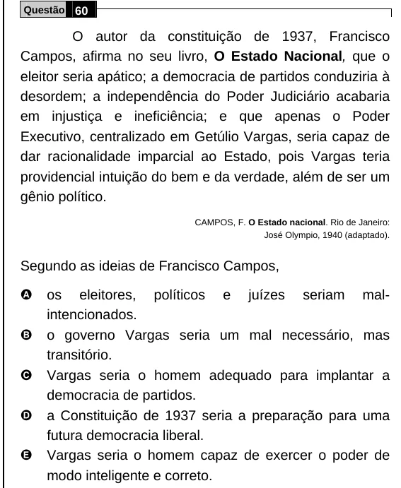

Texto extraído (pode conter ruído)

Questão 60  
O autor da constituição de 1937, Francisco  
Campos, afirma no seu livro, O Estado Nacional, que o  
eleitor seria apático; a democracia de partidos conduziria à  
desordem; a independência do Poder Judiciário acabaria  
em injustiça e ineficiência; e que apenas o Poder  
Executivo, centralizado em Getúlio Vargas, seria capaz de  
dar racionalidade imparcial ao Estado, pois Vargas teria  
providencial intuição do bem e da verdade, além de ser um  
gênio político.  
CAMPOS, F. O Estado nacional. Rio de Janeiro:  
José Olympio, 1940 (adaptado).  
Segundo as ideias de Francisco Campos,  
A  
os eleitores, políticos e juízes seriam mal-  
intencionados.  
B  
o governo Vargas seria um mal necessário, mas  
transitório.  
C  
Vargas seria o homem adequado para implantar a  
democracia de partidos.  
D  
a Constituição de 1937 seria a preparação para uma  
futura democracia liberal.  
E  
Vargas seria o homem capaz de exercer o poder de  
modo inteligente e correto.

