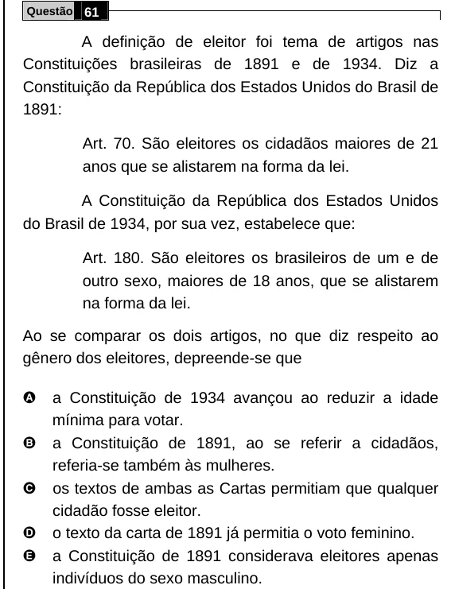

Texto extraído (pode conter ruído)

Questão 61  
A definição de eleitor foi tema de artigos nas  
Constituições brasileiras de 1891 e de 1934. Diz a  
Constituição da República dos Estados Unidos do Brasil de  
1891:  
Art. 70. São eleitores os cidadãos maiores de 21  
anos que se alistarem na forma da lei.  
A Constituição da República dos Estados Unidos  
do Brasil de 1934, por sua vez, estabelece que:  
Art. 180. São eleitores os brasileiros de um e de  
outro sexo, maiores de 18 anos, que se alistarem  
na forma da lei.  
Ao se comparar os dois artigos, no que diz respeito ao  
gênero dos eleitores, depreende-se que  
A  
a Constituição de 1934 avançou ao reduzir a idade  
mínima para votar.  
B  
a Constituição de 1891, ao se referir a cidadãos,  
referia-se também às mulheres.  
C  
os textos de ambas as Cartas permitiam que qualquer  
cidadão fosse eleitor.  
D  
o texto da carta de 1891 já permitia o voto feminino.  
E  
a Constituição de 1891 considerava eleitores apenas  
indivíduos do sexo masculino.

