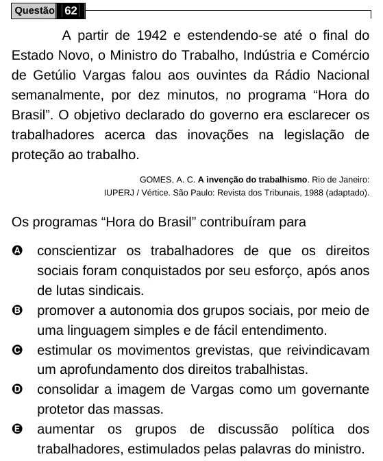

Texto extraído (pode conter ruído)

Questão 62  
A partir de 1942 e estendendo-se até o final do  
Estado Novo, o Ministro do Trabalho, Indústria e Comércio  
de Getúlio Vargas falou aos ouvintes da Rádio Nacional  
semanalmente, por dez minutos, no programa “Hora do  
Brasil”. O objetivo declarado do governo era esclarecer os  
trabalhadores acerca das inovações na legislação de  
proteção ao trabalho.  
GOMES, A. C. A invenção do trabalhismo. Rio de Janeiro:  
IUPERJ / Vértice. São Paulo: Revista dos Tribunais, 1988 (adaptado).  
Os programas “Hora do Brasil” contribuíram para  
A  
conscientizar os trabalhadores de que os direitos  
sociais foram conquistados por seu esforço, após anos  
de lutas sindicais.  
B  
promover a autonomia dos grupos sociais, por meio de  
uma linguagem simples e de fácil entendimento.  
C  
estimular os movimentos grevistas, que reivindicavam  
um aprofundamento dos direitos trabalhistas.  
D  
consolidar a imagem de Vargas como um governante  
protetor das massas.  
E  
aumentar os grupos de discussão política dos  
trabalhadores, estimulados pelas palavras do ministro.

