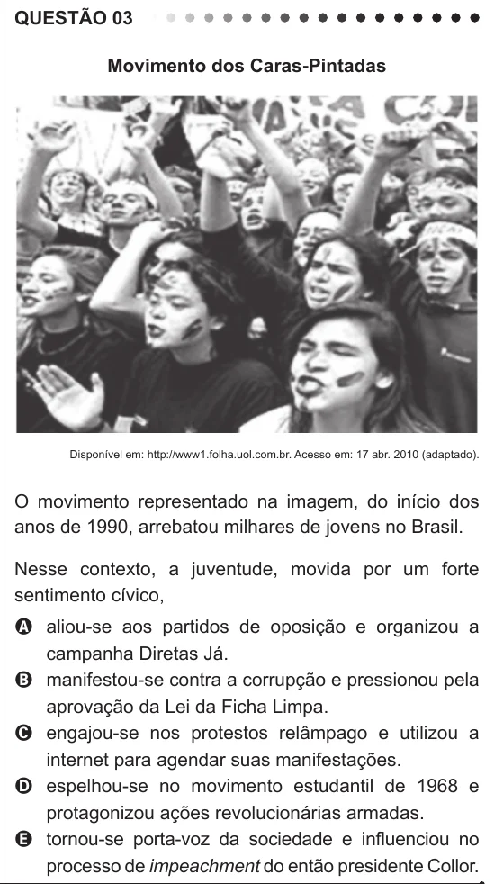

Texto extraído (pode conter ruído)

QUESTÃO 03  
Movimento dos Caras-Pintadas  
Disponível em: http://www1.folha.uol.com.br. Acesso em: 17 abr. 2010 (adaptado).  
O movimento representado na imagem, do início dos  
anos de 1990, arrebatou milhares de jovens no Brasil.  
Nesse contexto, a juventude, movida por um forte  
sentimento cívico,  
A aliou-se aos partidos de oposição e organizou a  
campanha Diretas Já.  
B manifestou-se contra a corrupção e pressionou pela  
aprovação da Lei da Ficha Limpa.  
C engajou-se nos protestos relâmpago e utilizou a  
internet para agendar suas manifestações.  
D espelhou-se no movimento estudantil de 1968 e  
protagonizou ações revolucionárias armadas.  
E tornou-se porta-voz da sociedade e influenciou no  
processo de impeachment do então presidente Collor.

