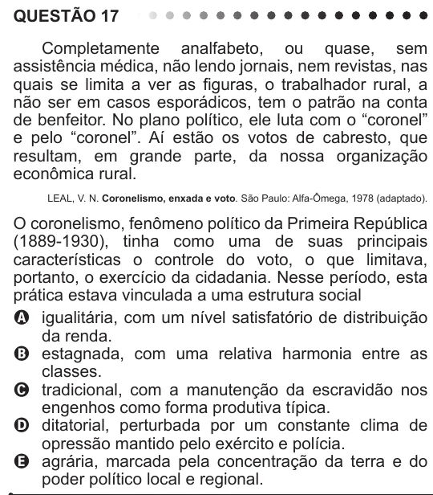

Texto extraído (pode conter ruído)

QUESTÃO 17  
Completamente analfabeto, ou quase, sem  
assistência médica, não lendo jornais, nem revistas, nas  
quais se limita a ver as figuras, o trabalhador rural, a  
não ser em casos esporádicos, tem o patrão na conta  
de benfeitor. No plano político, ele luta com o “coronel”  
e pelo “coronel”. Aí estão os votos de cabresto, que  
resultam, em grande parte, da nossa organização  
econômica rural.  
LEAL, V. N. Coronelismo, enxada e voto. São Paulo: Alfa-Ômega, 1978 (adaptado).  
O coronelismo, fenômeno político da Primeira República  
(1889-1930), tinha como uma de suas principais  
características o controle do voto, o que limitava,  
portanto, o exercício da cidadania. Nesse período, esta  
prática estava vinculada a uma estrutura social  
A igualitária, com um nível satisfatório de distribuição  
da renda.  
B estagnada, com uma relativa harmonia entre as  
classes.  
C tradicional, com a manutenção da escravidão nos  
engenhos como forma produtiva típica.  
D ditatorial, perturbada por um constante clima de  
opressão mantido pelo exército e polícia.  
E agrária, marcada pela concentração da terra e do  
poder político local e regional.

