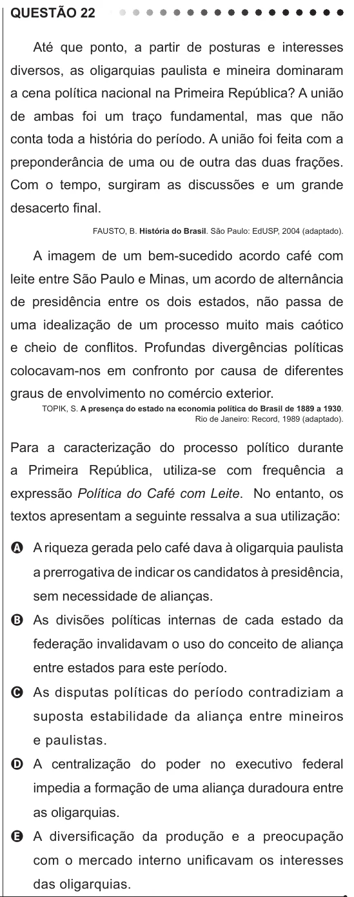

Texto extraído (pode conter ruído)

QUESTÃO 22  
Até que ponto, a partir de posturas e interesses  
diversos, as oligarquias paulista e mineira dominaram  
a cena política nacional na Primeira República? A união  
de ambas foi um traço fundamental, mas que não  
conta toda a história do período. A união foi feita com a  
preponderância de uma ou de outra das duas frações.  
Com o tempo, surgiram as discussões e um grande  
desacerto final.  
FAUSTO, B. História do Brasil. São Paulo: EdUSP, 2004 (adaptado).  
A imagem de um bem-sucedido acordo café com  
leite entre São Paulo e Minas, um acordo de alternância  
de presidência entre os dois estados, não passa de  
uma idealização de um processo muito mais caótico  
e cheio de conflitos. Profundas divergências políticas  
colocavam-nos em confronto por causa de diferentes  
graus de envolvimento no comércio exterior.  
TOPIK, S. A presença do estado na economia política do Brasil de 1889 a 1930.  
Rio de Janeiro: Record, 1989 (adaptado).  
Para a caracterização do processo político durante  
a Primeira República, utiliza-se com frequência a  
expressão Política do Café com Leite. No entanto, os  
textos apresentam a seguinte ressalva a sua utilização:  
A A riqueza gerada pelo café dava à oligarquia paulista  
a prerrogativa de indicar os candidatos à presidência,  
sem necessidade de alianças.  
B As divisões políticas internas de cada estado da  
federação invalidavam o uso do conceito de aliança  
entre estados para este período.  
C As disputas políticas do período contradiziam a  
suposta estabilidade da aliança entre mineiros  
e paulistas.  
D A centralização do poder no executivo federal  
impedia a formação de uma aliança duradoura entre  
as oligarquias.  
E A diversificação da produção e a preocupação  
com o mercado interno unificavam os interesses  
das oligarquias.

