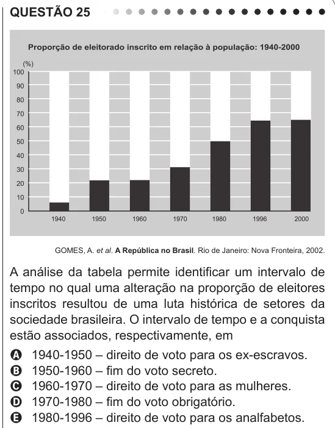

Texto extraído (pode conter ruído)

QUESTÃO 25  
GOMES, A. et al. A República no Brasil. Rio de Janeiro: Nova Fronteira, 2002.  
A análise da tabela permite identificar um intervalo de  
tempo no qual uma alteração na proporção de eleitores  
inscritos resultou de uma luta histórica de setores da  
sociedade brasileira. O intervalo de tempo e a conquista  
estão associados, respectivamente, em  
1940-1950 – direito de voto para os ex-escravos.  
A  
1950-1960 – fim do voto secreto.  
B  
C  
1960-1970 – direito de voto para as mulheres.  
D  
1970-1980 – fim do voto obrigatório.  
1980-1996 – direito de voto para os analfabetos.  
E

