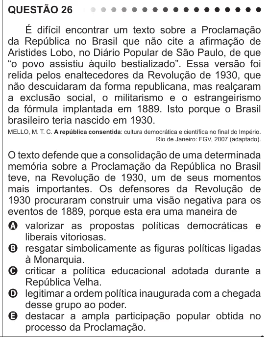

Texto extraído (pode conter ruído)

QUESTÃO 26  
É difícil encontrar um texto sobre a Proclamação  
da República no Brasil que não cite a afirmação de  
Aristides Lobo, no Diário Popular de São Paulo, de que  
“o povo assistiu àquilo bestializado”. Essa versão foi  
relida pelos enaltecedores da Revolução de 1930, que  
não descuidaram da forma republicana, mas realçaram  
a exclusão social, o militarismo e o estrangeirismo  
da fórmula implantada em 1889. Isto porque o Brasil  
brasileiro teria nascido em 1930.  
MELLO, M. T. C. A república consentida: cultura democrática e científica no final do Império.  
Rio de Janeiro: FGV, 2007 (adaptado).  
O texto defende que a consolidação de uma determinada  
memória sobre a Proclamação da República no Brasil  
teve, na Revolução de 1930, um de seus momentos  
mais importantes. Os defensores da Revolução de  
1930 procuraram construir uma visão negativa para os  
eventos de 1889, porque esta era uma maneira de  
A valorizar as propostas políticas democráticas e  
liberais vitoriosas.  
B resgatar simbolicamente as figuras políticas ligadas  
à Monarquia.  
C criticar a política educacional adotada durante a  
República Velha.  
D legitimar a ordem política inaugurada com a chegada  
desse grupo ao poder.  
E destacar a ampla participação popular obtida no  
processo da Proclamação.

