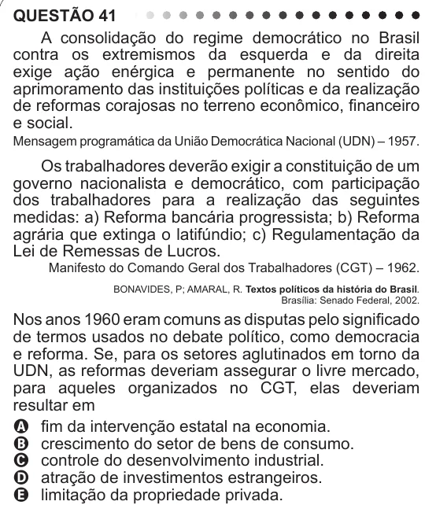

Texto extraído (pode conter ruído)

QUESTÃO 41  
A consolidação do regime democrático no Brasil  
contra os extremismos da esquerda e da direita  
exige ação enérgica e permanente no sentido do  
aprimoramento das instituições políticas e da realização  
de reformas corajosas no terreno econômico, financeiro  
e social.  
Mensagem programática da União Democrática Nacional (UDN) – 1957.  
Os trabalhadores deverão exigir a constituição de um  
governo nacionalista e democrático, com participação  
dos trabalhadores para a realização das seguintes  
medidas: a) Reforma bancária progressista; b) Reforma  
agrária que extinga o latifúndio; c) Regulamentação da  
Lei de Remessas de Lucros.  
Manifesto do Comando Geral dos Trabalhadores (CGT) – 1962.  
BONAVIDES, P; AMARAL, R. Textos políticos da história do Brasil.  
Brasília: Senado Federal, 2002.  
Nos anos 1960 eram comuns as disputas pelo significado  
de termos usados no debate político, como democracia  
e reforma. Se, para os setores aglutinados em torno da  
UDN, as reformas deveriam assegurar o livre mercado,  
para aqueles organizados no CGT, elas deveriam  
resultar em  
A fim da intervenção estatal na economia.  
B crescimento do setor de bens de consumo.  
C controle do desenvolvimento industrial.  
D atração de investimentos estrangeiros.  
E limitação da propriedade privada.

