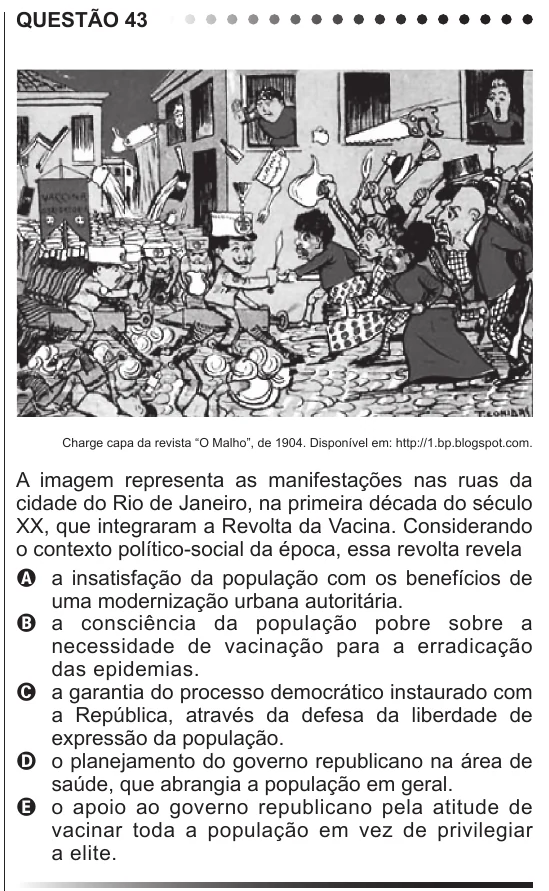

Texto extraído (pode conter ruído)

QUESTÃO 43  
Charge capa da revista “O Malho”, de 1904. Disponível em: http://1.bp.blogspot.com.  
A imagem representa as manifestações nas ruas da  
cidade do Rio de Janeiro, na primeira década do século  
XX, que integraram a Revolta da Vacina. Considerando  
o contexto político-social da época, essa revolta revela  
A a insatisfação da população com os benefícios de  
uma modernização urbana autoritária.  
B a consciência da população pobre sobre a  
necessidade de vacinação para a erradicação  
das epidemias.  
C a garantia do processo democrático instaurado com  
a República, através da defesa da liberdade de  
expressão da população.  
D o planejamento do governo republicano na área de  
saúde, que abrangia a população em geral.  
E o apoio ao governo republicano pela atitude de  
vacinar toda a população em vez de privilegiar  
a elite.

