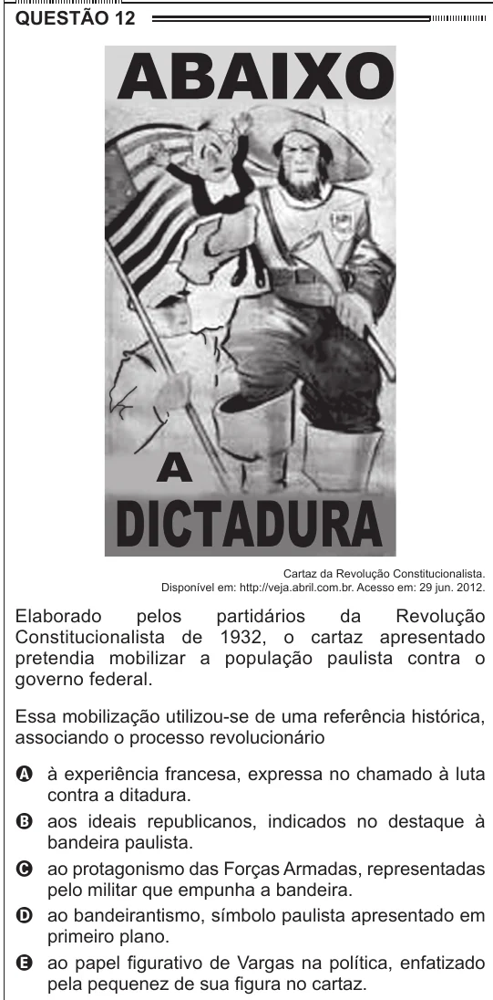

Texto extraído (pode conter ruído)

QUESTÃO 12  
Cartaz da Revolução Constitucionalista.  
Disponível em: http://veja.abril.com.br. Acesso em: 29 jun. 2012.  
Elaborado  
pelos  
partidários  
da  
Revolução  
Constitucionalista de 1932, o cartaz apresentado  
pretendia mobilizar a população paulista contra o  
governo federal.  
Essa mobilização utilizou-se de uma referência histórica,  
associando o processo revolucionário  
A à experiência francesa, expressa no chamado à luta  
contra a ditadura.  
B aos ideais republicanos, indicados no destaque à  
bandeira paulista.  
C ao protagonismo das Forças Armadas, representadas  
pelo militar que empunha a bandeira.  
D ao bandeirantismo, símbolo paulista apresentado em  
primeiro plano.  
E ao papel figurativo de Vargas na política, enfatizado  
pela pequenez de sua figura no cartaz.

