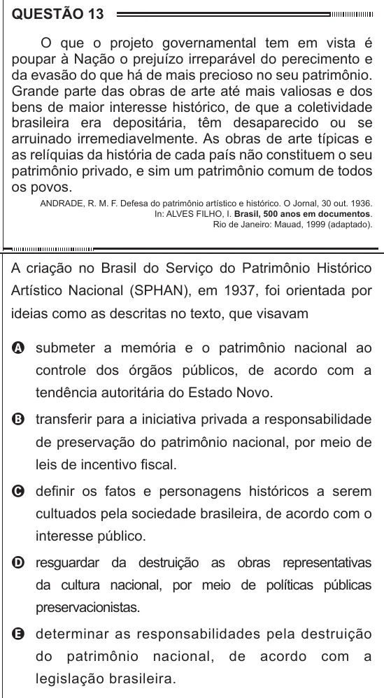

Texto extraído (pode conter ruído)

QUESTÃO 13  
O que o projeto governamental tem em vista é  
poupar à Nação o prejuízo irreparável do perecimento e  
da evasão do que há de mais precioso no seu patrimônio.  
Grande parte das obras de arte até mais valiosas e dos  
bens de maior interesse histórico, de que a coletividade  
brasileira era depositária, têm desaparecido ou se  
arruinado irremediavelmente. As obras de arte típicas e  
as relíquias da história de cada país não constituem o seu  
patrimônio privado, e sim um patrimônio comum de todos  
os povos.  
ANDRADE, R. M. F. Defesa do patrimônio artístico e histórico. O Jornal, 30 out. 1936.  
In: ALVES FILHO, I. Brasil, 500 anos em documentos.  
Rio de Janeiro: Mauad, 1999 (adaptado).  
A criação no Brasil do Serviço do Patrimônio Histórico  
Artístico Nacional (SPHAN), em 1937, foi orientada por  
ideias como as descritas no texto, que visavam  
A submeter a memória e o patrimônio nacional ao  
controle dos órgãos públicos, de acordo com a  
tendência autoritária do Estado Novo.  
B transferir para a iniciativa privada a responsabilidade  
de preservação do patrimônio nacional, por meio de  
leis de incentivo fiscal.  
C definir os fatos e personagens históricos a serem  
cultuados pela sociedade brasileira, de acordo com o  
interesse público.  
D resguardar da destruição as obras representativas  
da cultura nacional, por meio de políticas públicas  
preservacionistas.  
E determinar as responsabilidades pela destruição  
do  
patrimônio  
nacional,  
de  
acordo  
com  
a  
legislação brasileira.

