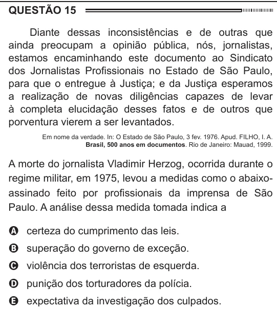

Texto extraído (pode conter ruído)

QUESTÃO 15  
Diante dessas inconsistências e de outras que  
ainda preocupam a opinião pública, nós, jornalistas,  
estamos encaminhando este documento ao Sindicato  
dos Jornalistas Profissionais no Estado de São Paulo,  
para que o entregue à Justiça; e da Justiça esperamos  
a realização de novas diligências capazes de levar  
à completa elucidação desses fatos e de outros que  
porventura vierem a ser levantados.  
Em nome da verdade. In: O Estado de São Paulo, 3 fev. 1976. Apud. FILHO, I. A.  
Brasil, 500 anos em documentos. Rio de Janeiro: Mauad, 1999.  
A morte do jornalista Vladimir Herzog, ocorrida durante o  
regime militar, em 1975, levou a medidas como o abaixo-  
assinado feito por profissionais da imprensa de São  
Paulo. A análise dessa medida tomada indica a  
A certeza do cumprimento das leis.  
B superação do governo de exceção.  
C violência dos terroristas de esquerda.  
D punição dos torturadores da polícia.  
E expectativa da investigação dos culpados.

