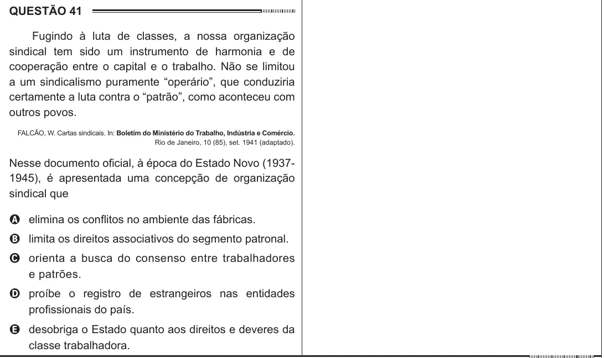

Texto extraído (pode conter ruído)

QUESTÃO 41  
Fugindo à luta de classes, a nossa organização  
sindical tem sido um instrumento de harmonia e de  
cooperação entre o capital e o trabalho. Não se limitou  
a um sindicalismo puramente “operário”, que conduziria  
certamente a luta contra o “patrão”, como aconteceu com  
outros povos.  
FALCÃO, W. Cartas sindicais. In: Boletim do Ministério do Trabalho, Indústria e Comércio.  
Rio de Janeiro, 10 (85), set. 1941 (adaptado).  
Nesse documento oficial, à época do Estado Novo (1937-  
1945), é apresentada uma concepção de organização  
sindical que  
A elimina os conflitos no ambiente das fábricas.  
B limita os direitos associativos do segmento patronal.  
C orienta a busca do consenso entre trabalhadores  
e patrões.  
D proíbe o registro de estrangeiros nas entidades  
profissionais do país.  
E desobriga o Estado quanto aos direitos e deveres da  
classe trabalhadora.

