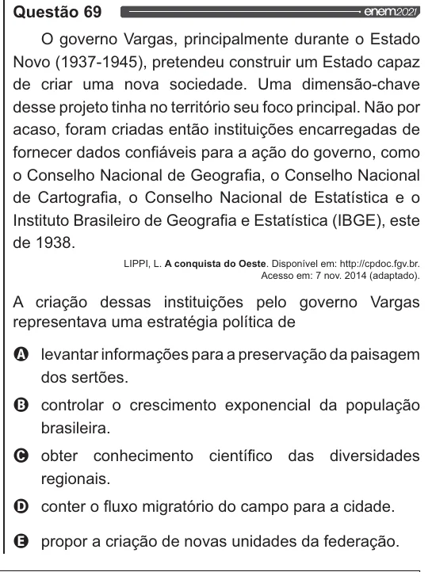

Texto extraído (pode conter ruído)

Questão 69  
O governo Vargas, principalmente durante o Estado  
Novo (1937-1945), pretendeu construir um Estado capaz  
de criar uma nova sociedade. Uma dimensão-chave  
desse projeto tinha no território seu foco principal. Não por  
acaso, foram criadas então instituições encarregadas de  
fornecer dados confiáveis para a ação do governo, como  
o Conselho Nacional de Geografia, o Conselho Nacional  
de Cartografia, o Conselho Nacional de Estatística e o  
Instituto Brasileiro de Geografia e Estatística (IBGE), este  
de 1938.  
LIPPI, L. A conquista do Oeste. Disponível em: http://cpdoc.fgv.br.  
Acesso em: 7 nov. 2014 (adaptado).  
A criação dessas instituições pelo governo Vargas  
representava uma estratégia política de  
Q levantarinformações para a preservação da paisagem  
dos sertões.  
O controlar o crescimento exponencial da população  
brasileira.  
O obter  
conhecimento científico das diversidades  
regionais.  
O conter o fluxo migratório do campo para a cidade.  
& propor a criação de novas unidades da federação.

