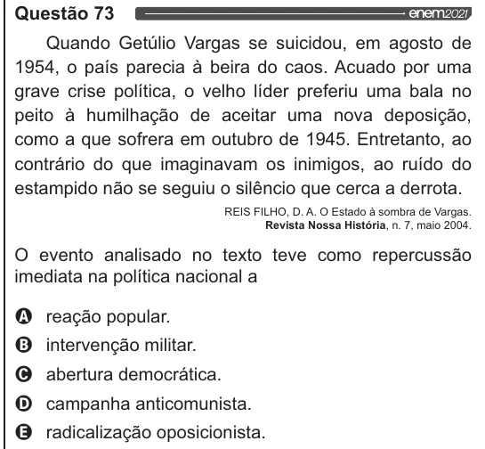

Texto extraído (pode conter ruído)

Questão 73  
Quando Getúlio Vargas se suicidou, em agosto de  
1954, o país parecia à beira do caos. Acuado por uma  
grave crise política, o velho líder preferiu uma bala no  
peito à humilhação de aceitar uma nova deposição,  
como a que sofrera em outubro de 1945. Entretanto, ao  
contrário do que imaginavam os inimigos, ao ruído do  
estampido não se seguiu o silêncio que cerca a derrota.  
REIS FILHO, D. A. O Estado à sombra de Vargas.  
Revista Nossa História, n. 7, maio 2004.  
O evento analisado no texto teve como repercussão  
imediata na política nacional a  
VOVOO  
reação popular.  
intervenção militar.  
abertura democrática.  
campanha anticomunista.  
radicalização oposicionista.

