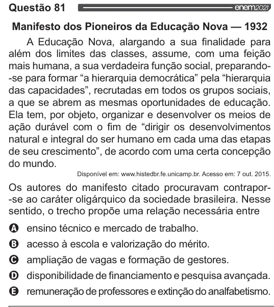

Texto extraído (pode conter ruído)

Questão 81  
Manifesto dos Pioneiros da Educação Nova — 1932  
A Educação Nova, alargando a sua finalidade para  
além dos limites das classes, assume, com uma feição  
mais humana, a sua verdadeira função social, preparando-  
-se para formar “a hierarquia democrática” pela “hierarquia  
das capacidades”, recrutadas em todos os grupos sociais,  
a que se abrem as mesmas oportunidades de educação.  
Ela tem, por objeto, organizar e desenvolver os meios de  
ação durável com o fim de “dirigir os desenvolvimentos  
natural e integral do ser humano em cada uma das etapas  
de seu crescimento”, de acordo com uma certa concepção  
do mundo.  
Disponível em: www.histedbr.fe.unicamp.br. Acesso em: 7 out. 2015.  
Os autores do manifesto citado procuravam contrapor-  
-se ao caráter oligárquico da sociedade brasileira. Nesse  
sentido, o trecho propõe uma relação necessária entre  
VOO  
ensino técnico e mercado de trabalho.  
acesso à escola e valorização do mérito.  
ampliação de vagas e formação de gestores.  
disponibilidade de financiamento e pesquisa avançada.  
remuneração de professores e extinção do analfabetismo.

