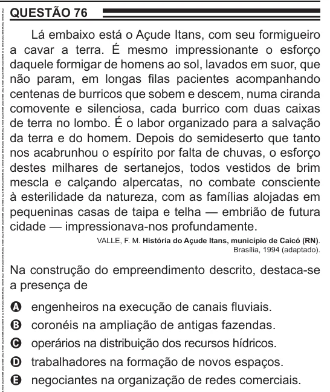

Texto extraído (pode conter ruído)

QUESTÃO 76  
Lá embaixo está o Açude Itans, com seu formigueiro  
a cavar a terra. É mesmo impressionante o esforço  
daquele formigar de homens ao sol, lavados em suor, que  
não param, em longas filas pacientes acompanhando  
centenas de burricos que sobem e descem, numa ciranda  
comovente e silenciosa, cada burrico com duas caixas  
de terra no lombo. É o labor organizado para a salvação  
da terra e do homem. Depois do semideserto que tanto  
nos acabrunhou o espírito por falta de chuvas, o esforço  
destes milhares de sertanejos, todos vestidos de brim  
mescla e calçando alpercatas, no combate consciente  
à esterilidade da natureza, com as famílias alojadas em  
pequeninas casas de taipa e telha — embrião de futura  
cidade — impressionava-nos profundamente.  
VALLE, F. M. História do Açude Itans, município de Caicó (RN).  
Brasília, 1994 (adaptado).  
Na construção do empreendimento descrito, destaca-se  
a presença de  
engenheiros na execução de canais fluviais.  
A  
coronéis na ampliação de antigas fazendas.  
B  
operários na distribuição dos recursos hídricos.  
C  
trabalhadores na formação de novos espaços.  
D  
negociantes na organização de redes comerciais.  
E

