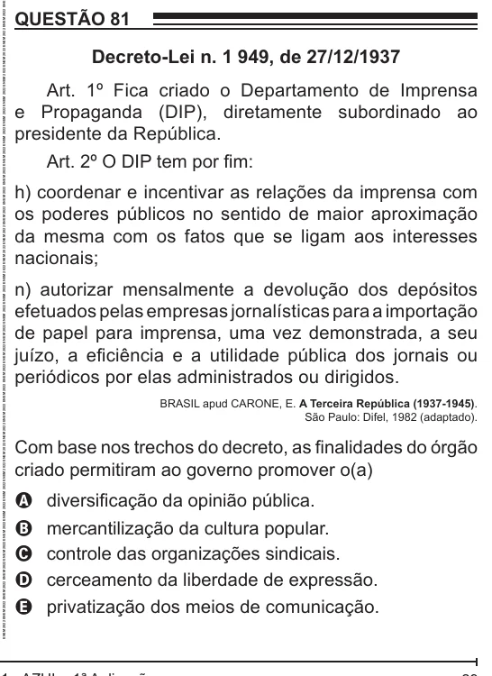

Texto extraído (pode conter ruído)

QUESTÃO 81  
Decreto-Lei n. 1 949, de 27/12/1937  
Art. 1º Fica criado o Departamento de Imprensa  
e Propaganda (DIP), diretamente subordinado ao  
presidente da República.  
Art. 2º O DIP tem por fim:  
h) coordenar e incentivar as relações da imprensa com  
os poderes públicos no sentido de maior aproximação  
da mesma com os fatos que se ligam aos interesses  
nacionais;  
n) autorizar mensalmente a devolução dos depósitos  
efetuados pelas empresas jornalísticas para a importação  
de papel para imprensa, uma vez demonstrada, a seu  
juízo, a eficiência e a utilidade pública dos jornais ou  
periódicos por elas administrados ou dirigidos.  
BRASIL apud CARONE, E. A Terceira República (1937-1945).  
São Paulo: Difel, 1982 (adaptado).  
Com base nos trechos do decreto, as finalidades do órgão  
criado permitiram ao governo promover o(a)  
diversificação da opinião pública.  
A  
mercantilização da cultura popular.  
B  
controle das organizações sindicais.  
C  
cerceamento da liberdade de expressão.  
D  
privatização dos meios de comunicação.  
E

