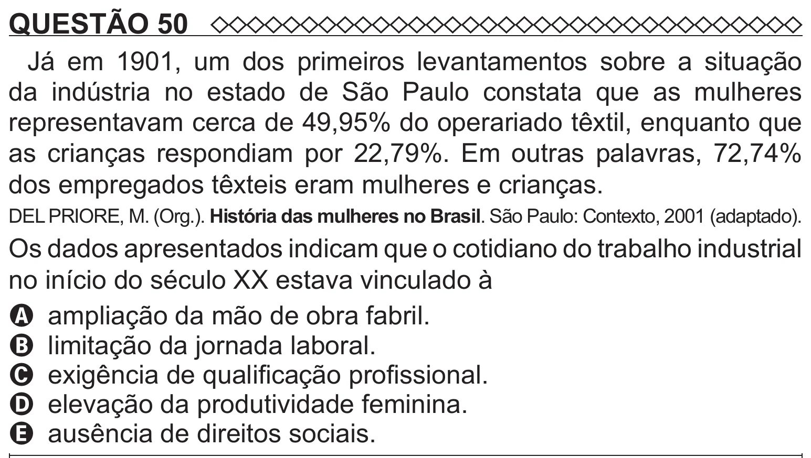

Texto extraído (pode conter ruído)

QUESTÃO 50  
Já em 1901, um dos primeiros levantamentos sobre a situação  
da indústria no estado de São Paulo constata que as mulheres  
representavam cerca de 49,95% do operariado têxtil, enquanto que  
as crianças respondiam por 22,79%. Em outras palavras, 72,74%  
dos empregados têxteis eram mulheres e crianças.  
DEL PRIORE, M. (Org.). História das mulheres no Brasil. São Paulo: Contexto, 2001 (adaptado).  
Os dados apresentados indicam que o cotidiano do trabalho industrial  
no início do século XX estava vinculado à  
A ampliação da mão de obra fabril.  
B limitação da jornada laboral.  
C exigência de qualificação profissional.  
D elevação da produtividade feminina.  
E ausência de direitos sociais.

