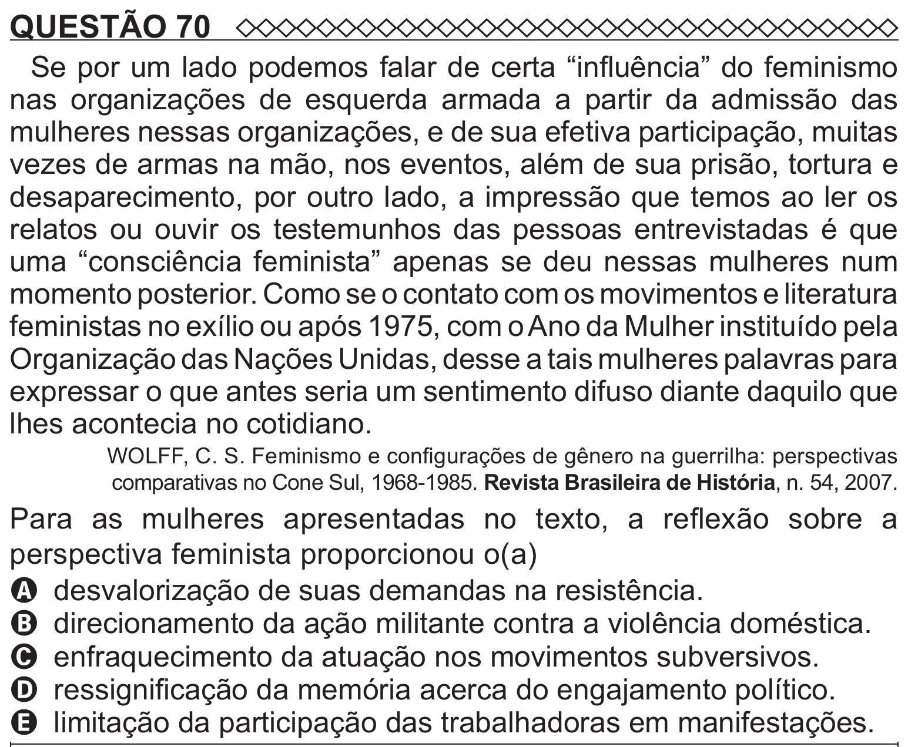

Texto extraído (pode conter ruído)

QUESTÃO 70  
Se por um lado podemos falar de certa “influência” do feminismo  
nas organizações de esquerda armada a partir da admissão das  
mulheres nessas organizações, e de sua efetiva participação, muitas  
vezes de armas na mão, nos eventos, além de sua prisão, tortura e  
desaparecimento, por outro lado, a impressão que temos ao ler os  
relatos ou ouvir os testemunhos das pessoas entrevistadas é que  
uma “consciência feminista” apenas se deu nessas mulheres num  
momento posterior. Como se o contato com os movimentos e literatura  
feministas no exílio ou após 1975, com o Ano da Mulher instituído pela  
Organização das Nações Unidas, desse a tais mulheres palavras para  
expressar o que antes seria um sentimento difuso diante daquilo que  
lhes acontecia no cotidiano.  
WOLFF, C. S. Feminismo e configurações de gênero na guerrilha: perspectivas  
comparativas no Cone Sul, 1968-1985. Revista Brasileira de História, n. 54, 2007.  
Para as mulheres apresentadas no texto, a reflexão sobre a  
perspectiva feminista proporcionou o(a)  
A desvalorização de suas demandas na resistência.  
B direcionamento da ação militante contra a violência doméstica.  
C enfraquecimento da atuação nos movimentos subversivos.  
D ressignificação da memória acerca do engajamento político.  
E limitação da participação das trabalhadoras em manifestações.

