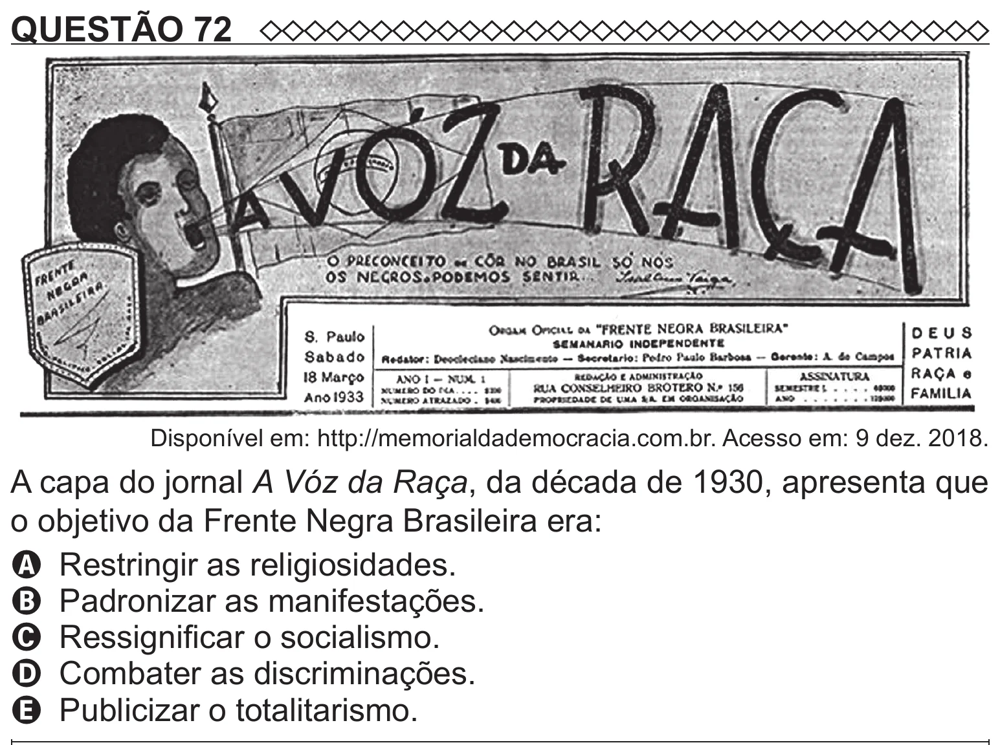

Texto extraído (pode conter ruído)

QUESTÃO 72  
Disponível em: http://memorialdademocracia.com.br. Acesso em: 9 dez. 2018.  
A capa do jornal A Vóz da Raça, da década de 1930, apresenta que  
o objetivo da Frente Negra Brasileira era:  
A Restringir as religiosidades.  
B Padronizar as manifestações.  
C Ressignificar o socialismo.  
D Combater as discriminações.  
E Publicizar o totalitarismo.

