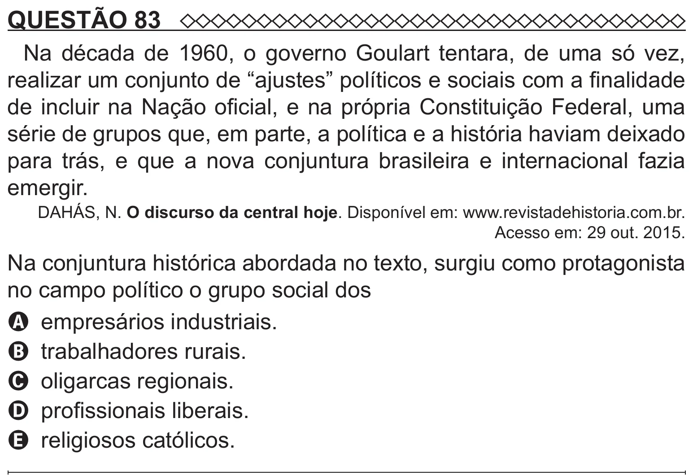

Texto extraído (pode conter ruído)

QUESTÃO 83  
Na década de 1960, o governo Goulart tentara, de uma só vez,  
realizar um conjunto de “ajustes” políticos e sociais com a finalidade  
de incluir na Nação oficial, e na própria Constituição Federal, uma  
série de grupos que, em parte, a política e a história haviam deixado  
para trás, e que a nova conjuntura brasileira e internacional fazia  
emergir.  
DAHÁS, N. O discurso da central hoje. Disponível em: www.revistadehistoria.com.br.  
Acesso em: 29 out. 2015.  
Na conjuntura histórica abordada no texto, surgiu como protagonista  
no campo político o grupo social dos  
A empresários industriais.  
B trabalhadores rurais.  
C oligarcas regionais.  
D profissionais liberais.  
E religiosos católicos.

