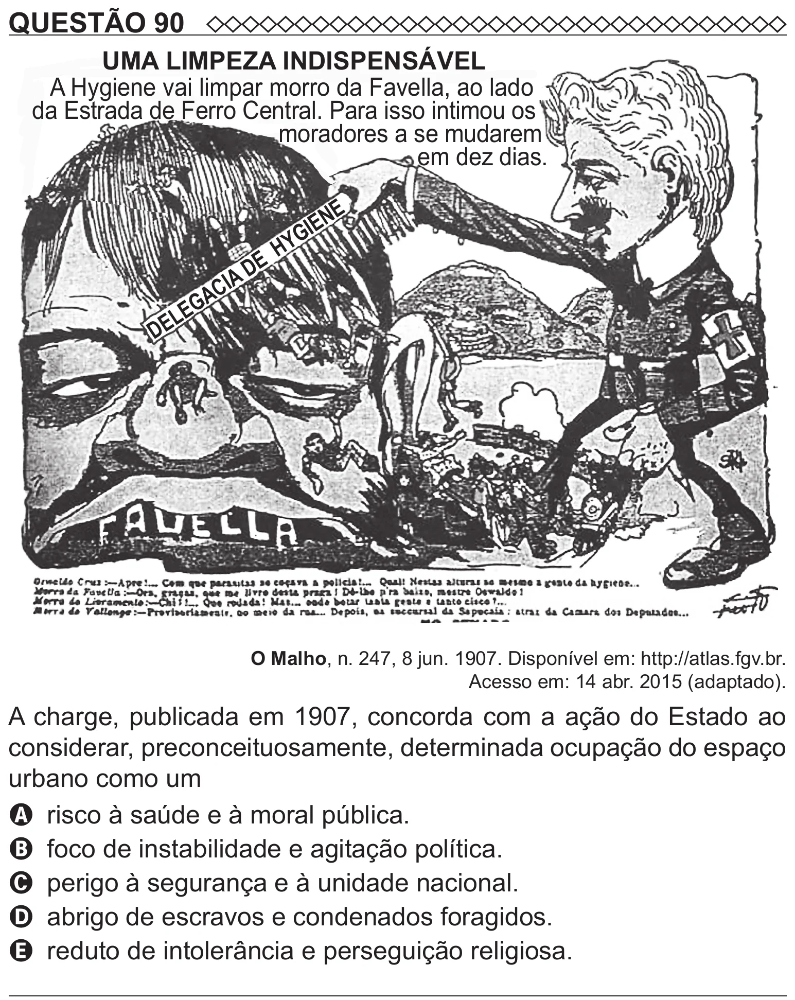

Texto extraído (pode conter ruído)

QUESTÃO 90  
UMA LIMPEZA INDISPENSÁVEL  
A Hygiene vai limpar morro da Favella, ao lado  
da Estrada de Ferro Central. Para isso intimou os  
moradores a se mudarem  
em dez dias.  
E  
N  
E  
I  
G  
HY  
E  
D  
A  
I  
C  
A  
G  
E  
L  
DE  
O Malho, n. 247, 8 jun. 1907. Disponível em: http://atlas.fgv.br.  
Acesso em: 14 abr. 2015 (adaptado).  
A charge, publicada em 1907, concorda com a ação do Estado ao  
considerar, preconceituosamente, determinada ocupação do espaço  
urbano como um  
A risco à saúde e à moral pública.  
B foco de instabilidade e agitação política.  
C perigo à segurança e à unidade nacional.  
D abrigo de escravos e condenados foragidos.  
E reduto de intolerância e perseguição religiosa.

