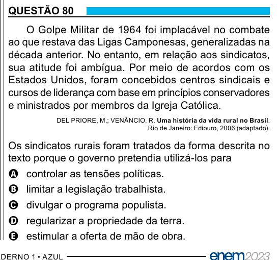

Texto extraído (pode conter ruído)

QUESTÃO 80  
O Golpe Militar de 1964 foi implacável no combate  
ao que restava das Ligas Camponesas, generalizadas na  
década anterior. No entanto, em relação aos sindicatos,  
sua atitude foi ambígua. Por meio de acordos com os  
Estados Unidos, foram concebidos centros sindicais e  
cursos de liderança com base em princípios conservadores  
e ministrados por membros da Igreja Católica.  
DEL PRIORE, M.; VENÂNCIO, R. Uma história da vida rural no Brasil.  
Rio de Janeiro: Ediouro, 2006 (adaptado).  
Os sindicatos rurais foram tratados da forma descrita no  
texto porque o governo pretendia utilizá-los para  
A controlar as tensões políticas.  
B limitar a legislação trabalhista.  
C divulgar o programa populista.  
D regularizar a propriedade da terra.  
E estimular a oferta de mão de obra.

