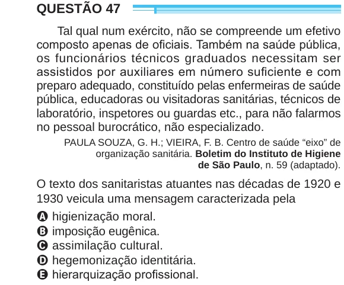

Texto extraído (pode conter ruído)

QUESTÃO 47  
Tal qual num exército, não se compreende um efetivo  
composto apenas de oficiais. Também na saúde pública,  
os funcionários técnicos graduados necessitam ser  
assistidos por auxiliares em número suficiente e com  
preparo adequado, constituído pelas enfermeiras de saúde  
pública, educadoras ou visitadoras sanitárias, técnicos de  
laboratório, inspetores ou guardas etc., para não falarmos  
no pessoal burocrático, não especializado.  
PAULA SOUZA, G. H.; VIEIRA, F. B. Centro de saúde “eixo” de  
organização sanitária. Boletim do Instituto de Higiene  
de São Paulo, n. 59 (adaptado).  
O texto dos sanitaristas atuantes nas décadas de 1920 e  
1930 veicula uma mensagem caracterizada pela  
A higienização moral.  
B imposição eugênica.  
C assimilação cultural.  
D hegemonização identitária.  
E hierarquização profissional.

