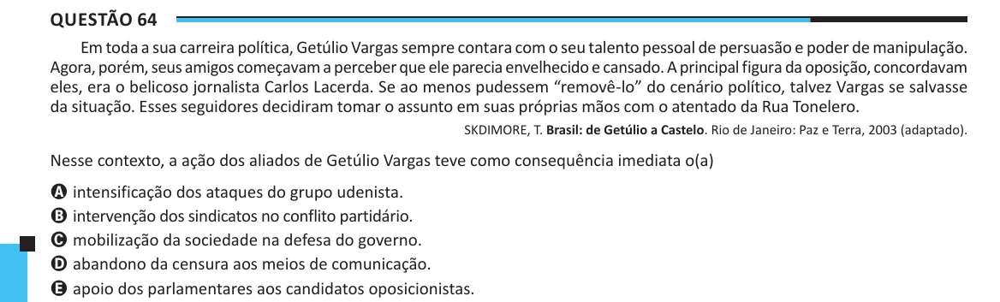

Texto extraído (pode conter ruído)

Questão 64  
Em toda a sua carreira política, Getúlio Vargas sempre contara com o seu talento pessoal de persuasão e poder de manipulação.  
Agora, porém, seus amigos começavam a perceber que ele parecia envelhecido e cansado. A principal figura da oposição, concordavam  
eles, era o belicoso jornalista Carlos Lacerda. Se ao menos pudessem “removê-lo” do cenário político, talvez Vargas se salvasse  
da situação. Esses seguidores decidiram tomar o assunto em suas próprias mãos com o atentado da Rua Tonelero.  
SKDIMORE, T. Brasil: de Getúlio a Castelo. Rio de Janeiro: Paz e Terra, 2003 (adaptado).  
Nesse contexto, a ação dos aliados de Getúlio Vargas teve como consequência imediata o(a)  
A intensificação dos ataques do grupo udenista.  
B intervenção dos sindicatos no conflito partidário.  
C mobilização da sociedade na defesa do governo.  
D abandono da censura aos meios de comunicação.  
E apoio dos parlamentares aos candidatos oposicionistas.

