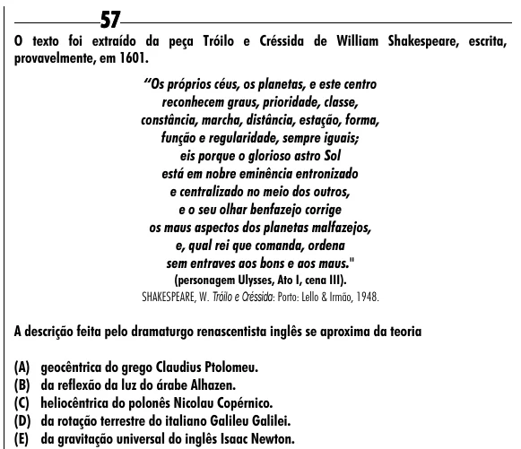

Texto extraído (pode conter ruído)

57  
O texto foi extraído da peça Tróilo e Créssida de William Shakespeare, escrita,  
provavelmente, em 1601.  
“Os próprios céus, os planetas, e este centro  
reconhecem graus, prioridade, classe,  
constância, marcha, distância, estação, forma,  
função e regularidade, sempre iguais;  
eis porque o glorioso astro Sol  
está em nobre eminência entronizado  
e centralizado no meio dos outros,  
e o seu olhar benfazejo corrige  
os maus aspectos dos planetas malfazejos,  
e, qual rei que comanda, ordena  
sem entraves aos bons e aos maus."  
(personagem Ulysses, Ato I, cena III).  
SHAKESPEARE, W. Tróilo e Créssida: Porto: Lello & Irmão, 1948.  
A descrição feita pelo dramaturgo renascentista inglês se aproxima da teoria  
(A) geocêntrica do grego Claudius Ptolomeu.  
(B) da reflexão da luz do árabe Alhazen.  
(C) heliocêntrica do polonês Nicolau Copérnico.  
(D) da rotação terrestre do italiano Galileu Galilei.  
(E) da gravitação universal do inglês Isaac Newton.

