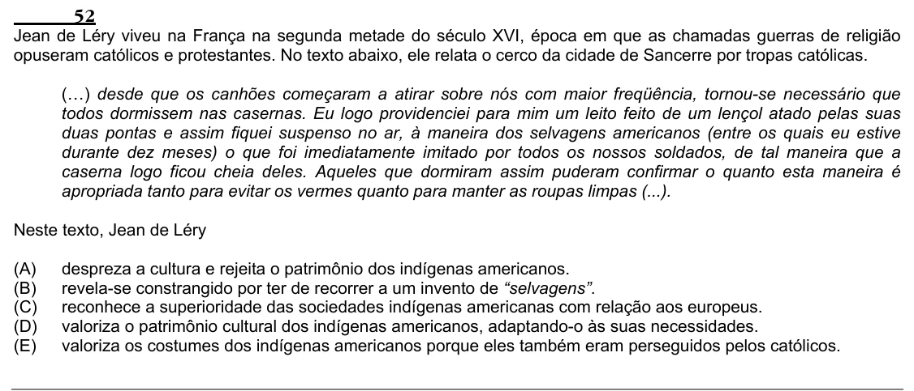

Texto extraído (pode conter ruído)

52  
Jean de Léry viveu na França na segunda metade do século XVI, época em que as chamadas guerras de religião  
opuseram católicos e protestantes. No texto abaixo, ele relata o cerco da cidade de Sancerre por tropas católicas.  
(…) desde que os canhões começaram a atirar sobre nós com maior freqüência, tornou-se necessário que  
todos dormissem nas casernas. Eu logo providenciei para mim um leito feito de um lençol atado pelas suas  
duas pontas e assim fiquei suspenso no ar, à maneira dos selvagens americanos (entre os quais eu estive  
durante dez meses) o que foi imediatamente imitado por todos os nossos soldados, de tal maneira que a  
caserna logo ficou cheia deles. Aqueles que dormiram assim puderam confirmar o quanto esta maneira é  
apropriada tanto para evitar os vermes quanto para manter as roupas limpas (...).  
Neste texto, Jean de Léry  
(A)  
despreza a cultura e rejeita o patrimônio dos indígenas americanos.  
(B)  
revela-se constrangido por ter de recorrer a um invento de “selvagens”.  
(C)  
reconhece a superioridade das sociedades indígenas americanas com relação aos europeus.  
(D)  
valoriza o patrimônio cultural dos indígenas americanos, adaptando-o às suas necessidades.  
(E)  
valoriza os costumes dos indígenas americanos porque eles também eram perseguidos pelos católicos.

