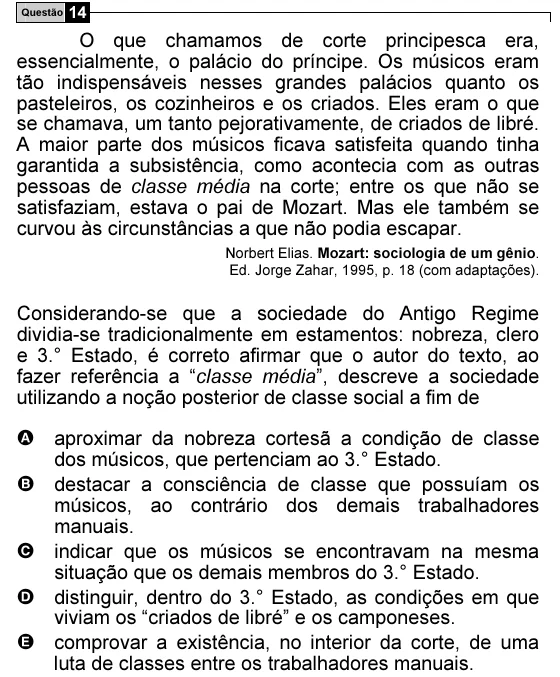

Texto extraído (pode conter ruído)

Questão 14  
O que chamamos de corte principesca era,  
essencialmente, o palácio do príncipe. Os músicos eram  
tão indispensáveis nesses grandes palácios quanto os  
pasteleiros, os cozinheiros e os criados. Eles eram o que  
se chamava, um tanto pejorativamente, de criados de libré.  
A maior parte dos músicos ficava satisfeita quando tinha  
garantida a subsistência, como acontecia com as outras  
pessoas de classe média na corte; entre os que não se  
satisfaziam, estava o pai de Mozart. Mas ele também se  
curvou às circunstâncias a que não podia escapar.  
Norbert Elias. Mozart: sociologia de um gênio.  
Ed. Jorge Zahar, 1995, p. 18 (com adaptações).  
Considerando-se que a sociedade do Antigo Regime  
dividia-se tradicionalmente em estamentos: nobreza, clero  
e 3.° Estado, é correto afirmar que o autor do texto, ao  
fazer referência a “classe média”, descreve a sociedade  
utilizando a noção posterior de classe social a fim de  
A aproximar da nobreza cortesã a condição de classe  
dos músicos, que pertenciam ao 3.° Estado.  
B destacar a consciência de classe que possuíam os  
músicos, ao contrário dos demais trabalhadores  
manuais.  
C indicar que os músicos se encontravam na mesma  
situação que os demais membros do 3.° Estado.  
D distinguir, dentro do 3.° Estado, as condições em que  
viviam os “criados de libré” e os camponeses.  
E comprovar a existência, no interior da corte, de uma  
luta de classes entre os trabalhadores manuais.

