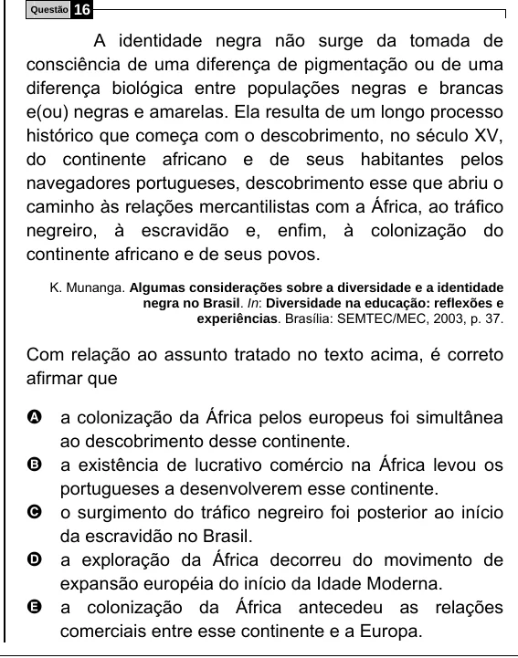

Texto extraído (pode conter ruído)

16  
Questão  
A identidade negra não surge da tomada de  
consciência de uma diferença de pigmentação ou de uma  
diferença biológica entre populações negras e brancas  
e(ou) negras e amarelas. Ela resulta de um longo processo  
histórico que começa com o descobrimento, no século XV,  
do continente africano e de seus habitantes pelos  
navegadores portugueses, descobrimento esse que abriu o  
caminho às relações mercantilistas com a África, ao tráfico  
negreiro, à escravidão e, enfim, à colonização do  
continente africano e de seus povos.  
K. Munanga. Algumas considerações sobre a diversidade e a identidade  
negra no Brasil. In: Diversidade na educação: reflexões e  
experiências. Brasília: SEMTEC/MEC, 2003, p. 37.  
Com relação ao assunto tratado no texto acima, é correto  
afirmar que  
A a colonização da África pelos europeus foi simultânea  
ao descobrimento desse continente.  
B a existência de lucrativo comércio na África levou os  
portugueses a desenvolverem esse continente.  
C o surgimento do tráfico negreiro foi posterior ao início  
da escravidão no Brasil.  
D a exploração da África decorreu do movimento de  
expansão européia do início da Idade Moderna.  
E a colonização da África antecedeu as relações  
comerciais entre esse continente e a Europa.

