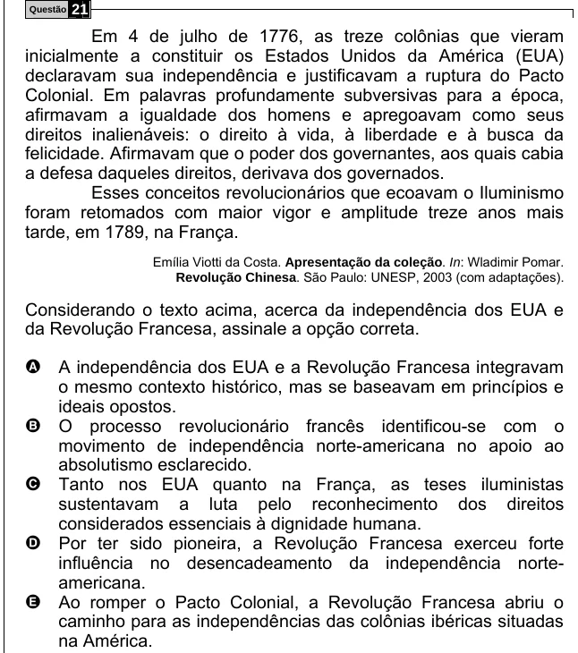

Texto extraído (pode conter ruído)

Questão  
21  
Em 4 de julho de 1776, as treze colônias que vieram  
inicialmente a constituir os Estados Unidos da América (EUA)  
declaravam sua independência e justificavam a ruptura do Pacto  
Colonial. Em palavras profundamente subversivas para a época,  
afirmavam a igualdade dos homens e apregoavam como seus  
direitos inalienáveis: o direito à vida, à liberdade e à busca da  
felicidade. Afirmavam que o poder dos governantes, aos quais cabia  
a defesa daqueles direitos, derivava dos governados.  
Esses conceitos revolucionários que ecoavam o Iluminismo  
foram retomados com maior vigor e amplitude treze anos mais  
tarde, em 1789, na França.  
Emília Viotti da Costa. Apresentação da coleção. In: Wladimir Pomar.  
Revolução Chinesa. São Paulo: UNESP, 2003 (com adaptações).  
Considerando o texto acima, acerca da independência dos EUA e  
da Revolução Francesa, assinale a opção correta.  
A A independência dos EUA e a Revolução Francesa integravam  
o mesmo contexto histórico, mas se baseavam em princípios e  
ideais opostos.  
O processo revolucionário francês identificou-se com o  
B  
movimento de independência norte-americana no apoio ao  
absolutismo esclarecido.  
C  
Tanto nos EUA quanto na França, as teses iluministas  
sustentavam a luta pelo reconhecimento dos direitos  
considerados essenciais à dignidade humana.  
Por ter sido pioneira, a Revolução Francesa exerceu forte  
D  
influência no desencadeamento da independência norte-  
americana.  
E  
Ao romper o Pacto Colonial, a Revolução Francesa abriu o  
caminho para as independências das colônias ibéricas situadas  
na América.

