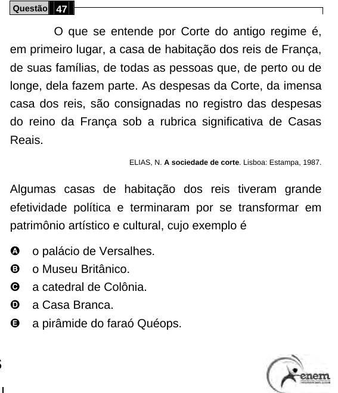

Texto extraído (pode conter ruído)

Questão 47  
O que se entende por Corte do antigo regime é,  
em primeiro lugar, a casa de habitação dos reis de França,  
de suas famílias, de todas as pessoas que, de perto ou de  
longe, dela fazem parte. As despesas da Corte, da imensa  
casa dos reis, são consignadas no registro das despesas  
do reino da França sob a rubrica significativa de Casas  
Reais.  
ELIAS, N. A sociedade de corte. Lisboa: Estampa, 1987.  
Algumas casas de habitação dos reis tiveram grande  
efetividade política e terminaram por se transformar em  
patrimônio artístico e cultural, cujo exemplo é  
A  
o palácio de Versalhes.  
B  
o Museu Britânico.  
C  
a catedral de Colônia.  
D  
a Casa Branca.  
E  
a pirâmide do faraó Quéops.

