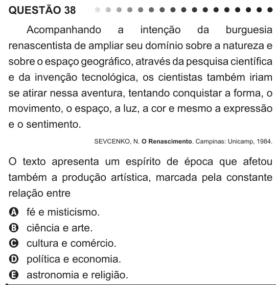

Texto extraído (pode conter ruído)

QUESTÃO 38  
Acompanhando  
a  
intenção  
da  
burguesia  
renascentista de ampliar seu domínio sobre a natureza e  
sobre o espaço geográfico, através da pesquisa científica  
e da invenção tecnológica, os cientistas também iriam  
se atirar nessa aventura, tentando conquistar a forma, o  
movimento, o espaço, a luz, a cor e mesmo a expressão  
e o sentimento.  
SEVCENKO, N. O Renascimento. Campinas: Unicamp, 1984.  
O texto apresenta um espírito de época que afetou  
também a produção artística, marcada pela constante  
relação entre  
fé e misticismo.  
A  
ciência e arte.  
B  
cultura e comércio.  
C  
política e economia.  
D  
astronomia e religião.  
E

