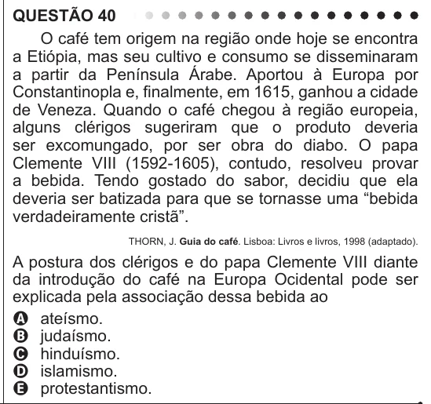

Texto extraído (pode conter ruído)

QUESTÃO 40  
O café tem origem na região onde hoje se encontra  
a Etiópia, mas seu cultivo e consumo se disseminaram  
a partir da Península Árabe. Aportou à Europa por  
Constantinopla e, finalmente, em 1615, ganhou a cidade  
de Veneza. Quando o café chegou à região europeia,  
alguns clérigos sugeriram que o produto deveria  
ser excomungado, por ser obra do diabo. O papa  
Clemente VIII (1592-1605), contudo, resolveu provar  
a bebida. Tendo gostado do sabor, decidiu que ela  
deveria ser batizada para que se tornasse uma “bebida  
verdadeiramente cristã”.  
THORN, J. Guia do café. Lisboa: Livros e livros, 1998 (adaptado).  
A postura dos clérigos e do papa Clemente VIII diante  
da introdução do café na Europa Ocidental pode ser  
explicada pela associação dessa bebida ao  
A ateísmo.  
B judaísmo.  
C hinduísmo.  
D islamismo.  
E protestantismo.

