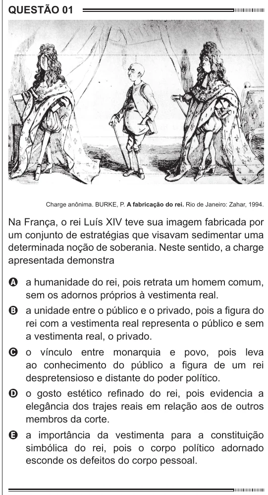

Texto extraído (pode conter ruído)

QUESTÃO 01  
Charge anônima. BURKE, P. A fabricação do rei. Rio de Janeiro: Zahar, 1994.  
Na França, o rei Luís XIV teve sua imagem fabricada por  
um conjunto de estratégias que visavam sedimentar uma  
determinada noção de soberania. Neste sentido, a charge  
apresentada demonstra  
A a humanidade do rei, pois retrata um homem comum,  
sem os adornos próprios à vestimenta real.  
B a unidade entre o público e o privado, pois a figura do  
rei com a vestimenta real representa o público e sem  
a vestimenta real, o privado.  
C o vínculo entre monarquia e povo, pois leva  
ao conhecimento do público a figura de um rei  
despretensioso e distante do poder político.  
D o gosto estético refinado do rei, pois evidencia a  
elegância dos trajes reais em relação aos de outros  
membros da corte.  
E a importância da vestimenta para a constituição  
simbólica do rei, pois o corpo político adornado  
esconde os defeitos do corpo pessoal.

