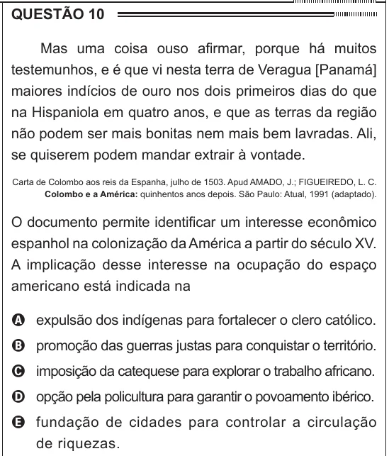

Texto extraído (pode conter ruído)

QUESTÃO 10  
Mas uma coisa ouso afirmar, porque há muitos  
testemunhos, e é que vi nesta terra de Veragua [Panamá]  
maiores indícios de ouro nos dois primeiros dias do que  
na Hispaniola em quatro anos, e que as terras da região  
não podem ser mais bonitas nem mais bem lavradas. Ali,  
se quiserem podem mandar extrair à vontade.  
Carta de Colombo aos reis da Espanha, julho de 1503. Apud AMADO, J.; FIGUEIREDO, L. C.  
Colombo e a América: quinhentos anos depois. São Paulo: Atual, 1991 (adaptado).  
O documento permite identificar um interesse econômico  
espanhol na colonização da América a partir do século XV.  
A implicação desse interesse na ocupação do espaço  
americano está indicada na  
A expulsão dos indígenas para fortalecer o clero católico.  
B promoção das guerras justas para conquistar o território.  
C imposição da catequese para explorar o trabalho africano.  
D opção pela policultura para garantir o povoamento ibérico.  
E fundação de cidades para controlar a circulação  
de riquezas.

