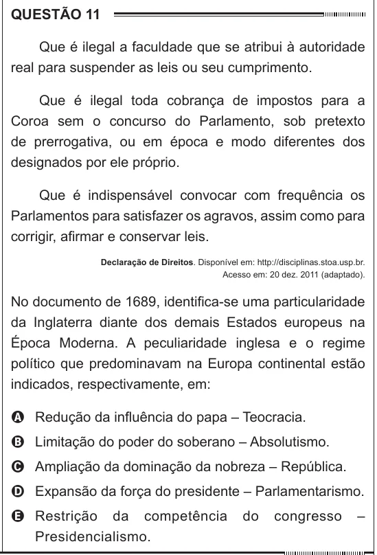

Texto extraído (pode conter ruído)

QUESTÃO 11  
Que é ilegal a faculdade que se atribui à autoridade  
real para suspender as leis ou seu cumprimento.  
Que é ilegal toda cobrança de impostos para a  
Coroa sem o concurso do Parlamento, sob pretexto  
de prerrogativa, ou em época e modo diferentes dos  
designados por ele próprio.  
Que é indispensável convocar com frequência os  
Parlamentos para satisfazer os agravos, assim como para  
corrigir, afirmar e conservar leis.  
Declaração de Direitos. Disponível em: http://disciplinas.stoa.usp.br.  
Acesso em: 20 dez. 2011 (adaptado).  
No documento de 1689, identifica-se uma particularidade  
da Inglaterra diante dos demais Estados europeus na  
Época Moderna. A peculiaridade inglesa e o regime  
político que predominavam na Europa continental estão  
indicados, respectivamente, em:  
A Redução da influência do papa – Teocracia.  
B Limitação do poder do soberano – Absolutismo.  
C Ampliação da dominação da nobreza – República.  
D Expansão da força do presidente – Parlamentarismo.  
E Restrição da competência  
do  
congresso  
–  
Presidencialismo.

