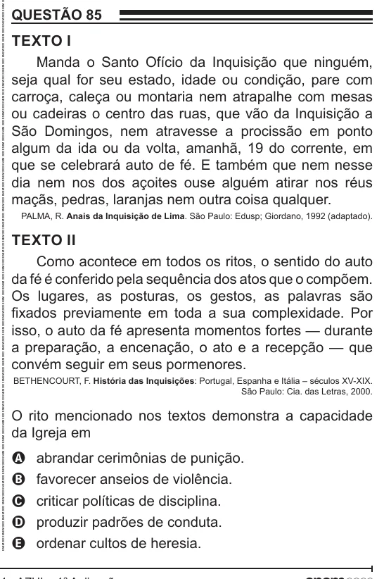

Texto extraído (pode conter ruído)

QUESTÃO 85  
TEXTO I  
Manda o Santo Ofício da Inquisição que ninguém,  
seja qual for seu estado, idade ou condição, pare com  
carroça, caleça ou montaria nem atrapalhe com mesas  
ou cadeiras o centro das ruas, que vão da Inquisição a  
São Domingos, nem atravesse a procissão em ponto  
algum da ida ou da volta, amanhã, 19 do corrente, em  
que se celebrará auto de fé. E também que nem nesse  
dia nem nos dos açoites ouse alguém atirar nos réus  
maçãs, pedras, laranjas nem outra coisa qualquer.  
PALMA, R. Anais da Inquisição de Lima. São Paulo: Edusp; Giordano, 1992 (adaptado).  
TEXTO II  
Como acontece em todos os ritos, o sentido do auto  
da fé é conferido pela sequência dos atos que o compõem.  
Os lugares, as posturas, os gestos, as palavras são  
fixados previamente em toda a sua complexidade. Por  
isso, o auto da fé apresenta momentos fortes — durante  
a preparação, a encenação, o ato e a recepção — que  
convém seguir em seus pormenores.  
BETHENCOURT, F. História das Inquisições: Portugal, Espanha e Itália – séculos XV-XIX.  
São Paulo: Cia. das Letras, 2000.  
O rito mencionado nos textos demonstra a capacidade  
da Igreja em  
abrandar cerimônias de punição.  
A  
favorecer anseios de violência.  
B  
C  
criticar políticas de disciplina.  
produzir padrões de conduta.  
D  
ordenar cultos de heresia.  
E

