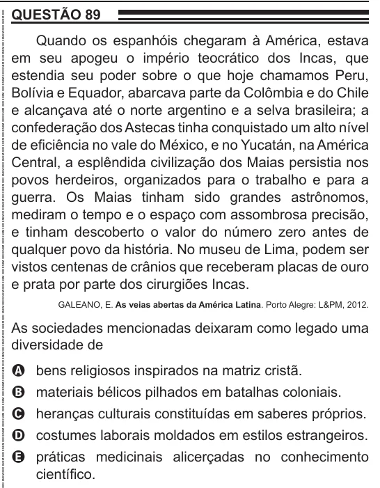

Texto extraído (pode conter ruído)

QUESTÃO 89  
Quando os espanhóis chegaram à América, estava  
em seu apogeu o império teocrático dos Incas, que  
estendia seu poder sobre o que hoje chamamos Peru,  
Bolívia e Equador, abarcava parte da Colômbia e do Chile  
e alcançava até o norte argentino e a selva brasileira; a  
confederação dos Astecas tinha conquistado um alto nível  
de eficiência no vale do México, e no Yucatán, na América  
Central, a esplêndida civilização dos Maias persistia nos  
povos herdeiros, organizados para o trabalho e para a  
guerra. Os Maias tinham sido grandes astrônomos,  
mediram o tempo e o espaço com assombrosa precisão,  
e tinham descoberto o valor do número zero antes de  
qualquer povo da história. No museu de Lima, podem ser  
vistos centenas de crânios que receberam placas de ouro  
e prata por parte dos cirurgiões Incas.  
GALEANO, E. As veias abertas da América Latina. Porto Alegre: L&PM, 2012.  
As sociedades mencionadas deixaram como legado uma  
diversidade de  
A bens religiosos inspirados na matriz cristã.  
B materiais bélicos pilhados em batalhas coloniais.  
C heranças culturais constituídas em saberes próprios.  
D costumes laborais moldados em estilos estrangeiros.  
E práticas medicinais alicerçadas no conhecimento  
científico.

