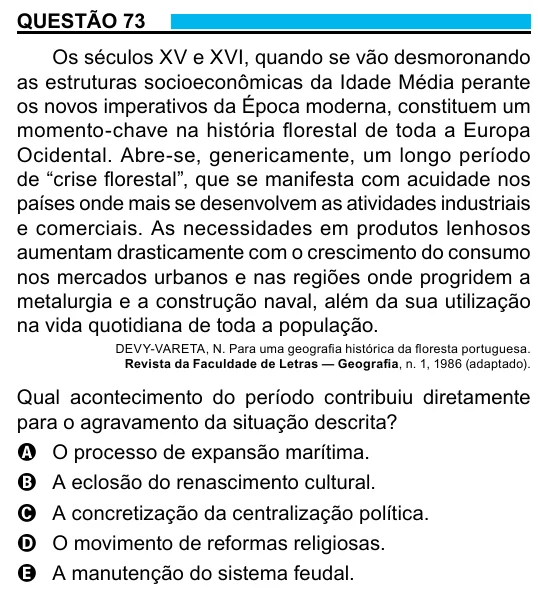

Texto extraído (pode conter ruído)

QUESTÃO 73  
Os séculos XV e XVI, quando se vão desmoronando  
as estruturas socioeconômicas da Idade Média perante  
os novos imperativos da Época moderna, constituem um  
momento-chave na história florestal de toda a Europa  
Ocidental. Abre-se, genericamente, um longo período  
de “crise florestal”, que se manifesta com acuidade nos  
países onde mais se desenvolvem as atividades industriais  
e comerciais. As necessidades em produtos lenhosos  
aumentam drasticamente com o crescimento do consumo  
nos mercados urbanos e nas regiões onde progridem a  
metalurgia e a construção naval, além da sua utilização  
na vida quotidiana de toda a população.  
DEVY-VARETA, N. Para uma geografia histórica da floresta portuguesa.  
Revista da Faculdade de Letras — Geografia, n. 1, 1986 (adaptado).  
Qual acontecimento do período contribuiu diretamente  
para o agravamento da situação descrita?  
A O processo de expansão marítima.  
B A eclosão do renascimento cultural.  
C A concretização da centralização política.  
D O movimento de reformas religiosas.  
E A manutenção do sistema feudal.

