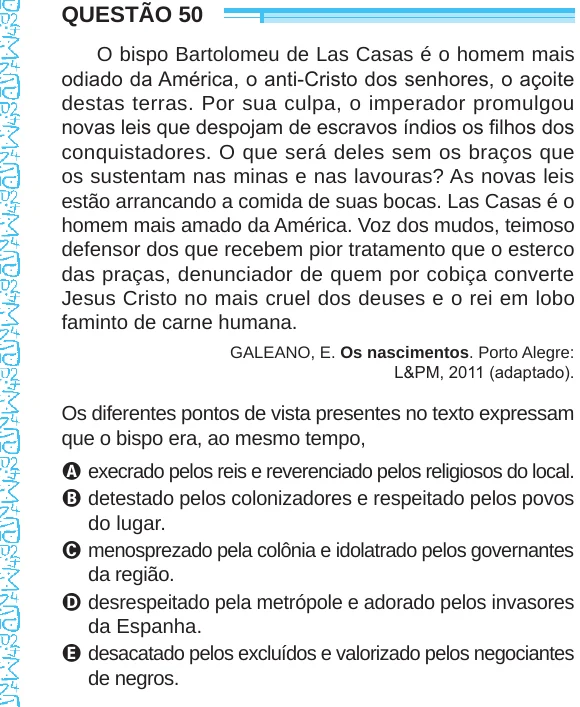

Texto extraído (pode conter ruído)

QUESTÃO 50  
O bispo Bartolomeu de Las Casas é o homem mais  
odiado da América, o anti-Cristo dos senhores, o açoite  
destas terras. Por sua culpa, o imperador promulgou  
novas leis que despojam de escravos índios os filhos dos  
conquistadores. O que será deles sem os braços que  
os sustentam nas minas e nas lavouras? As novas leis  
estão arrancando a comida de suas bocas. Las Casas é o  
homem mais amado da América. Voz dos mudos, teimoso  
defensor dos que recebem pior tratamento que o esterco  
das praças, denunciador de quem por cobiça converte  
Jesus Cristo no mais cruel dos deuses e o rei em lobo  
faminto de carne humana.  
GALEANO, E. Os nascimentos. Porto Alegre:  
L&PM, 2011 (adaptado).  
Os diferentes pontos de vista presentes no texto expressam  
que o bispo era, ao mesmo tempo,  
A execrado pelos reis e reverenciado pelos religiosos do local.  
B detestado pelos colonizadores e respeitado pelos povos  
do lugar.  
C menosprezado pela colônia e idolatrado pelos governantes  
da região.  
D desrespeitado pela metrópole e adorado pelos invasores  
da Espanha.  
E desacatado pelos excluídos e valorizado pelos negociantes  
de negros.

