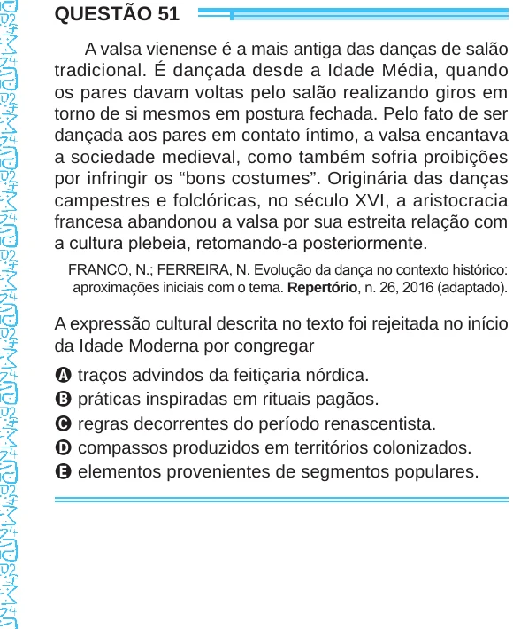

Texto extraído (pode conter ruído)

QUESTÃO 51  
A valsa vienense é a mais antiga das danças de salão  
tradicional. É dançada desde a Idade Média, quando  
os pares davam voltas pelo salão realizando giros em  
torno de si mesmos em postura fechada. Pelo fato de ser  
dançada aos pares em contato íntimo, a valsa encantava  
a sociedade medieval, como também sofria proibições  
por infringir os “bons costumes”. Originária das danças  
campestres e folclóricas, no século XVI, a aristocracia  
francesa abandonou a valsa por sua estreita relação com  
a cultura plebeia, retomando-a posteriormente.  
FRANCO, N.; FERREIRA, N. Evolução da dança no contexto histórico:  
aproximações iniciais com o tema. Repertório, n. 26, 2016 (adaptado).  
A expressão cultural descrita no texto foi rejeitada no início  
da Idade Moderna por congregar  
A traços advindos da feitiçaria nórdica.  
B práticas inspiradas em rituais pagãos.  
C regras decorrentes do período renascentista.  
D compassos produzidos em territórios colonizados.  
E elementos provenientes de segmentos populares.

