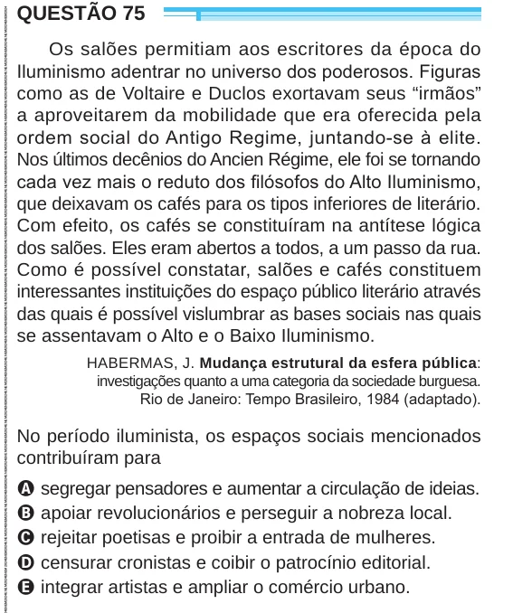

Texto extraído (pode conter ruído)

QUESTÃO 75  
Os salões permitiam aos escritores da época do  
Iluminismo adentrar no universo dos poderosos. Figuras  
como as de Voltaire e Duclos exortavam seus “irmãos”  
a aproveitarem da mobilidade que era oferecida pela  
ordem social do Antigo Regime, juntando-se à elite.  
Nos últimos decênios do Ancien Régime, ele foi se tornando  
cada vez mais o reduto dos filósofos do Alto Iluminismo,  
que deixavam os cafés para os tipos inferiores de literário.  
Com efeito, os cafés se constituíram na antítese lógica  
dos salões. Eles eram abertos a todos, a um passo da rua.  
Como é possível constatar, salões e cafés constituem  
interessantes instituições do espaço público literário através  
das quais é possível vislumbrar as bases sociais nas quais  
se assentavam o Alto e o Baixo Iluminismo.  
HABERMAS, J. Mudança estrutural da esfera pública:  
investigações quanto a uma categoria da sociedade burguesa.  
Rio de Janeiro: Tempo Brasileiro, 1984 (adaptado).  
No período iluminista, os espaços sociais mencionados  
contribuíram para  
A segregar pensadores e aumentar a circulação de ideias.  
B apoiar revolucionários e perseguir a nobreza local.  
C rejeitar poetisas e proibir a entrada de mulheres.  
D censurar cronistas e coibir o patrocínio editorial.  
E integrar artistas e ampliar o comércio urbano.

