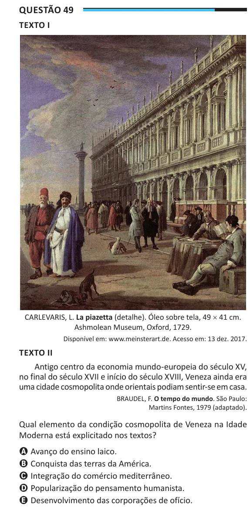

Texto extraído (pode conter ruído)

Questão 49  
TEXTO I  
CARLEVARIS, L. La piazetta (detalhe). Óleo sobre tela, 49 × 41 cm.  
Ashmolean Museum, Oxford, 1729.  
Disponível em: www.meinsterart.de. Acesso em: 13 dez. 2017.  
TEXTO II  
Antigo centro da economia mundo-europeia do século XV,  
no final do século XVII e início do século XVIII, Veneza ainda era  
uma cidade cosmopolita onde orientais podiam sentir-se em casa.  
BRAUDEL, F. O tempo do mundo. São Paulo:  
Martins Fontes, 1979 (adaptado).  
Qual elemento da condição cosmopolita de Veneza na Idade  
Moderna está explicitado nos textos?  
A Avanço do ensino laico.  
B Conquista das terras da América.  
C Integração do comércio mediterrâneo.  
D Popularização do pensamento humanista.  
E Desenvolvimento das corporações de ofício.

