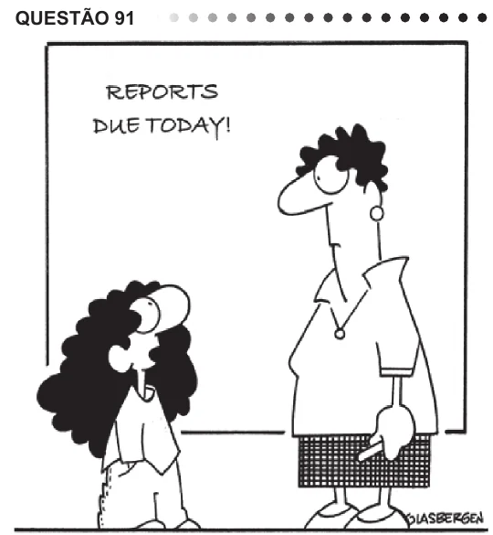

Texto extraído (pode conter ruído)

QUESTÃO 91  
GLASBERGEN, R. Today’s cartoon.  
Disponível em: http://www.glasbergen.com. Acesso em: 23 jul. 2010.  
Na fase escolar, é prática comum que os professores  
passem atividades extraclasse e marquem uma data  
para que as mesmas sejam entregues para correção.  
No caso da cena da charge, a professora ouve uma  
estudante apresentando argumentos para  
discutir sobre o conteúdo do seu trabalho já entregue.  
A  
elogiar o tema proposto para o relatório solicitado.  
B  
C  
sugerir temas para novas pesquisas e relatórios.  
reclamar do curto prazo para entrega do trabalho.  
D  
convencer de que fez o relatório solicitado.  
E  
QUESTÃO 91  
Los fallos de software en aparatos médicos, como  
marcapasos, van a ser una creciente amenaza para la  
salud pública, según el informe de Software Freedom Law  
Center (SFLC) que ha sido presentado hoy en Portland  
(EEUU), en la Open Source Convention (OSCON).  
La ponencia “Muerto por el código: transparencia  
de software en los dispositivos médicos implantables”  
aborda el riesgo potencialmente mortal de los defectos  
informáticos en los aparatos médicos implantados en las  
personas.  
Según SFLC, millones de personas con condiciones  
crónicas del corazón, epilepsia, diabetes, obesidad e,  
incluso, la depresión dependen de implantes, pero el  
software permanece oculto a los pacientes y sus médicos.  
La SFLC recuerda graves fallos informáticos  
ocurridos en otros campos, como en elecciones, en la  
fabricación de coches, en las líneas aéreas comerciales  
o en los mercados financieros.  
Disponível em: http://www.elpais.com. Acesso em: 24 jul. 2010 (adaptado).  
O título da palestra, citado no texto, antecipa o tema que  
será tratado e mostra que o autor tem a intenção de  
A relatar novas experiências em tratamento de saúde.  
B alertar sobre os riscos mortais de determinados  
softwares de uso médico para o ser humano.  
C denunciar falhas médicas na implantação de  
softwares em seres humanos.  
D divulgar novos softwares presentes em aparelhos  
médicos lançados no mercado.  
E apresentar os defeitos mais comuns de softwares  
em aparelhos médicos.

