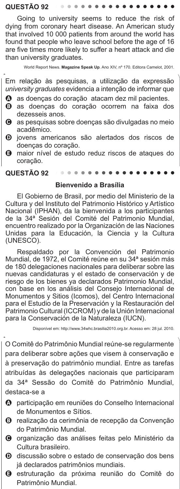

Texto extraído (pode conter ruído)

QUESTÃO 92  
Going to university seems to reduce the risk of  
dying from coronary heart disease. An American study  
that involved 10 000 patients from around the world has  
found that people who leave school before the age of 16  
are five times more likely to suffer a heart attack and die  
than university graduates.  
World Report News. Magazine Speak Up. Ano XIV, nº 170. Editora Camelot, 2001.  
Em relação às pesquisas, a utilização da expressão  
university graduates evidencia a intenção de informar que  
A as doenças do coração atacam dez mil pacientes.  
B as doenças do coração ocorrem na faixa dos  
dezesseis anos.  
C as pesquisas sobre doenças são divulgadas no meio  
acadêmico.  
D jovens americanos são alertados dos riscos de  
doenças do coração.  
E maior nível de estudo reduz riscos de ataques do  
coração.  
QUESTÃO 92  
Bienvenido a Brasília  
El Gobierno de Brasil, por medio del Ministerio de la  
Cultura y del Instituto del Patrimonio Histórico y Artístico  
Nacional (IPHAN), da la bienvenida a los participantes  
de la 34ª Sesión del Comité del Patrimonio Mundial,  
encuentro realizado por la Organización de las Naciones  
Unidas para la Educación, la Ciencia y la Cultura  
(UNESCO).  
Respaldado por la Convención del Patrimonio  
Mundial, de 1972, el Comité reúne en su 34ª sesión más  
de 180 delegaciones nacionales para deliberar sobre las  
nuevas candidaturas y el estado de conservación y de  
riesgo de los bienes ya declarados Patrimonio Mundial,  
con base en los análisis del Consejo Internacional de  
Monumentos y Sitios (Icomos), del Centro Internacional  
para el Estudio de la Preservación y la Restauración del  
Patrimonio Cultural (ICCROM) y de la Unión Internacional  
para la Conservación de la Naturaleza (IUCN).  
Disponível em: http://www.34whc.brasilia2010.org.br. Acesso em: 28 jul. 2010.  
O Comitê do Patrimônio Mundial reúne-se regularmente  
para deliberar sobre ações que visem à conservação e  
à preservação do patrimônio mundial. Entre as tarefas  
atribuídas às delegações nacionais que participaram  
da 34ª Sessão do Comitê do Patrimônio Mundial,  
destaca-se a  
A participação em reuniões do Conselho Internacional  
de Monumentos e Sítios.  
B realização da cerimônia de recepção da Convenção  
do Patrimônio Mundial.  
C organização das análises feitas pelo Ministério da  
Cultura brasileiro.  
D discussão sobre o estado de conservação dos bens  
já declarados patrimônios mundiais.  
E estruturação da próxima reunião do Comitê do  
Patrimônio Mundial.

