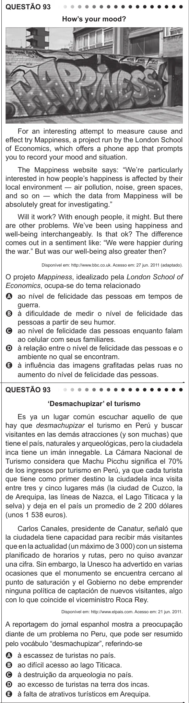

Texto extraído (pode conter ruído)

QUESTÃO 93  
How’s your mood?  
For an interesting attempt to measure cause and  
effect try Mappiness, a project run by the London School  
of Economics, which offers a phone app that prompts  
you to record your mood and situation.  
The Mappiness website says: “We’re particularly  
interested in how people’s happiness is affected by their  
local environment ― air pollution, noise, green spaces,  
and so on ― which the data from Mappiness will be  
absolutely great for investigating.”  
Will it work? With enough people, it might. But there  
are other problems. We’ve been using happiness and  
well-being interchangeably. Is that ok? The difference  
comes out in a sentiment like: “We were happier during  
the war.” But was our well-being also greater then?  
Disponível em: http://www.bbc.co.uk. Acesso em: 27 jun. 2011 (adaptado).  
O projeto Mappiness, idealizado pela London School of  
Economics, ocupa-se do tema relacionado  
A ao nível de felicidade das pessoas em tempos de  
guerra.  
B à dificuldade de medir o nível de felicidade das  
pessoas a partir de seu humor.  
C ao nível de felicidade das pessoas enquanto falam  
ao celular com seus familiares.  
D à relação entre o nível de felicidade das pessoas e o  
ambiente no qual se encontram.  
E à influência das imagens grafitadas pelas ruas no  
aumento do nível de felicidade das pessoas.  
QUESTÃO 93  
‘Desmachupizar’ el turismo  
Es ya un lugar común escuchar aquello de que  
hay que desmachupizar el turismo en Perú y buscar  
visitantes en las demás atracciones (y son muchas) que  
tiene el país, naturales y arqueológicas, pero la ciudadela  
inca tiene un imán innegable. La Cámara Nacional de  
Turismo considera que Machu Picchu significa el 70%  
de los ingresos por turismo en Perú, ya que cada turista  
que tiene como primer destino la ciudadela inca visita  
entre tres y cinco lugares más (la ciudad de Cuzco, la  
de Arequipa, las líneas de Nazca, el Lago Titicaca y la  
selva) y deja en el país un promedio de 2 200 dólares  
(unos 1 538 euros).  
Carlos Canales, presidente de Canatur, señaló que  
la ciudadela tiene capacidad para recibir más visitantes  
que en la actualidad (un máximo de 3 000) con un sistema  
planificado de horarios y rutas, pero no quiso avanzar  
una cifra. Sin embargo, la Unesco ha advertido en varias  
ocasiones que el monumento se encuentra cercano al  
punto de saturación y el Gobierno no debe emprender  
ninguna política de captación de nuevos visitantes, algo  
con lo que coincide el viceministro Roca Rey.  
Disponível em: http://www.elpais.com. Acesso em: 21 jun. 2011.  
A reportagem do jornal espanhol mostra a preocupação  
diante de um problema no Peru, que pode ser resumido  
pelo vocábulo “desmachupizar”, referindo-se  
à escassez de turistas no país.  
A  
ao difícil acesso ao lago Titicaca.  
B  
à destruição da arqueologia no país.  
C  
D  
ao excesso de turistas na terra dos incas.  
à falta de atrativos turísticos em Arequipa.  
E

