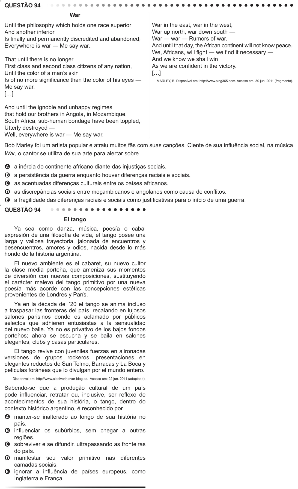

Texto extraído (pode conter ruído)

QUESTÃO 94  
War  
Until the philosophy which holds one race superior  
War in the east, war in the west,  
And another inferior  
War up north, war down south ―  
Is finally and permanently discredited and abandoned,  
War ― war ― Rumors of war.  
Everywhere is war ― Me say war.  
And until that day, the African continent will not know peace.  
We, Africans, will fight ― we find it necessary ―  
That until there is no longer  
And we know we shall win  
First class and second class citizens of any nation,  
As we are confident in the victory.  
Until the color of a man’s skin  
[…]  
Is of no more significance than the color of his eyes ―  
MARLEY, B. Disponível em: http://www.sing365.com. Acesso em: 30 jun. 2011 (fragmento).  
Me say war.  
[…]  
And until the ignoble and unhappy regimes  
that hold our brothers in Angola, in Mozambique,  
South Africa, sub-human bondage have been toppled,  
Utterly destroyed ―  
Well, everywhere is war ― Me say war.  
Bob Marley foi um artista popular e atraiu muitos fãs com suas canções. Ciente de sua influência social, na música  
War, o cantor se utiliza de sua arte para alertar sobre  
A  
a inércia do continente africano diante das injustiças sociais.  
B  
a persistência da guerra enquanto houver diferenças raciais e sociais.  
as acentuadas diferenças culturais entre os países africanos.  
C  
as discrepâncias sociais entre moçambicanos e angolanos como causa de conflitos.  
D  
a fragilidade das diferenças raciais e sociais como justificativas para o início de uma guerra.  
E  
QUESTÃO 94  
El tango  
Ya sea como danza, música, poesía o cabal  
expresión de una filosofía de vida, el tango posee una  
larga y valiosa trayectoria, jalonada de encuentros y  
desencuentros, amores y odios, nacida desde lo más  
hondo de la historia argentina.  
El nuevo ambiente es el cabaret, su nuevo cultor  
la clase media porteña, que ameniza sus momentos  
de diversión con nuevas composiciones, sustituyendo  
el carácter malevo del tango primitivo por una nueva  
poesía más acorde con las concepciones estéticas  
provenientes de Londres y París.  
Ya en la década del ‘20 el tango se anima incluso  
a traspasar las fronteras del país, recalando en lujosos  
salones parisinos donde es aclamado por públicos  
selectos que adhieren entusiastas a la sensualidad  
del nuevo baile. Ya no es privativo de los bajos fondos  
porteños; ahora se escucha y se baila en salones  
elegantes, clubs y casas particulares.  
El tango revive con juveniles fuerzas en ajironadas  
versiones de grupos rockeros, presentaciones en  
elegantes reductos de San Telmo, Barracas y La Boca y  
películas foráneas que lo divulgan por el mundo entero.  
Disponível em: http://www.elpolvorin.over-blog.es. Acesso em: 22 jun. 2011 (adaptado).  
Sabendo-se que a produção cultural de um país  
pode influenciar, retratar ou, inclusive, ser reflexo de  
acontecimentos de sua história, o tango, dentro do  
contexto histórico argentino, é reconhecido por  
A manter-se inalterado ao longo de sua história no  
país.  
B influenciar os subúrbios, sem chegar a outras  
regiões.  
C sobreviver e se difundir, ultrapassando as fronteiras  
do país.  
D manifestar seu valor primitivo nas diferentes  
camadas sociais.  
E ignorar a influência de países europeus, como  
Inglaterra e França.

