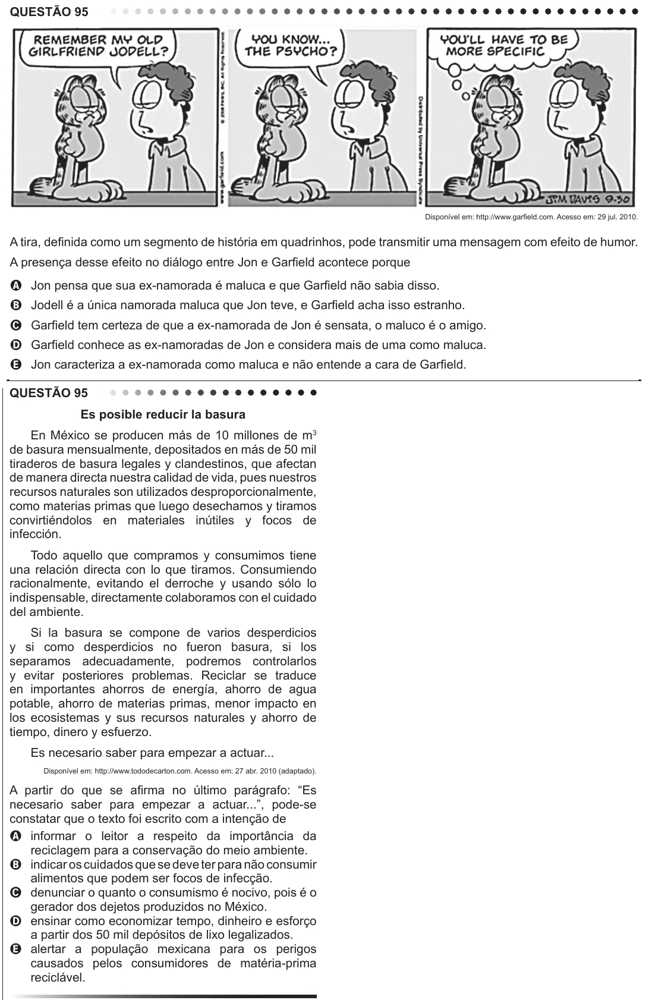

Texto extraído (pode conter ruído)

QUESTÃO 95  
Disponível em: http://www.garfield.com. Acesso em: 29 jul. 2010.  
A tira, definida como um segmento de história em quadrinhos, pode transmitir uma mensagem com efeito de humor.  
A presença desse efeito no diálogo entre Jon e Garfield acontece porque  
A Jon pensa que sua ex-namorada é maluca e que Garfield não sabia disso.  
B Jodell é a única namorada maluca que Jon teve, e Garfield acha isso estranho.  
C Garfield tem certeza de que a ex-namorada de Jon é sensata, o maluco é o amigo.  
D Garfield conhece as ex-namoradas de Jon e considera mais de uma como maluca.  
E Jon caracteriza a ex-namorada como maluca e não entende a cara de Garfield.  
QUESTÃO 95  
Es posible reducir la basura  
En México se producen más de 10 millones de m 3  
de basura mensualmente, depositados en más de 50 mil  
tiraderos de basura legales y clandestinos, que afectan  
de manera directa nuestra calidad de vida, pues nuestros  
recursos naturales son utilizados desproporcionalmente,  
como materias primas que luego desechamos y tiramos  
convirtiéndolos en materiales inútiles y focos de  
infección.  
Todo aquello que compramos y consumimos tiene  
una relación directa con lo que tiramos. Consumiendo  
racionalmente, evitando el derroche y usando sólo lo  
indispensable, directamente colaboramos con el cuidado  
del ambiente.  
Si la basura se compone de varios desperdicios  
y si como desperdicios no fueron basura, si los  
separamos adecuadamente, podremos controlarlos  
y evitar posteriores problemas. Reciclar se traduce  
en importantes ahorros de energía, ahorro de agua  
potable, ahorro de materias primas, menor impacto en  
los ecosistemas y sus recursos naturales y ahorro de  
tiempo, dinero y esfuerzo.  
Es necesario saber para empezar a actuar...  
Disponível em: http://www.tododecarton.com. Acesso em: 27 abr. 2010 (adaptado).  
A partir do que se afirma no último parágrafo: “Es  
necesario saber para empezar a actuar...”, pode-se  
constatar que o texto foi escrito com a intenção de  
A informar o leitor a respeito da importância da  
reciclagem para a conservação do meio ambiente.  
B indicar os cuidados que se deve ter para não consumir  
alimentos que podem ser focos de infecção.  
C denunciar o quanto o consumismo é nocivo, pois é o  
gerador dos dejetos produzidos no México.  
D ensinar como economizar tempo, dinheiro e esforço  
a partir dos 50 mil depósitos de lixo legalizados.  
E alertar a população mexicana para os perigos  
causados pelos consumidores de matéria-prima  
reciclável.

